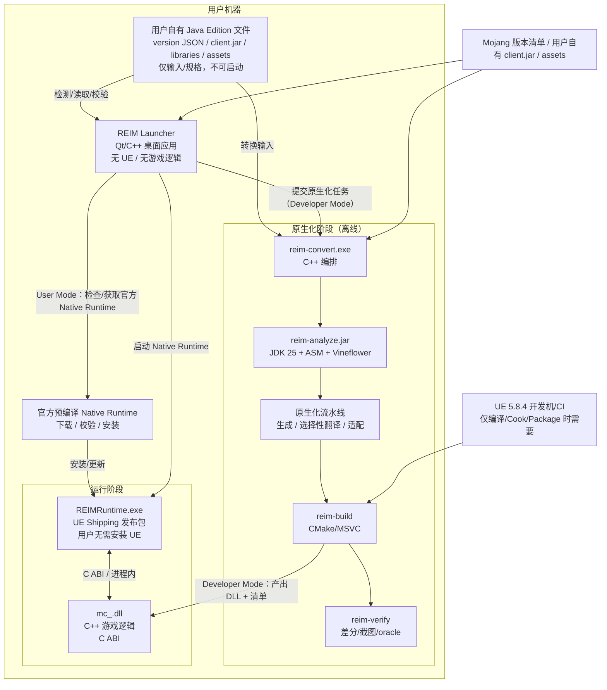

# REIM 技术架构设计

> 文档版本：**4.0（REIM Native Launcher 定稿版）**  
> 日期：2026-11-18  
> 项目名称：**REIM Launcher** — Minecraft Reimagined. A New Native Minecraft Experience  
> 主版本基线：**Minecraft Java Edition 26.3**（协议 777 / DataVersion 5023 / 资源包 97.1 / 数据包 121.0 / Java 25）  
> 游戏运行时引擎基线：**Unreal Engine 5.8.4**（开发/编译/Cook/Package 基线；用户侧不安装 UE）  
> 文档性质：产品定位、进程边界、Native 运行时与渲染路线基线。**REIM 是 Minecraft Native Launcher，不是 Java Edition Launcher；不提供启动原版 Java Minecraft 的能力。**

---

## 0. 一页结论

### 0.1 产品是什么

REIM 是一个 **Minecraft Native Launcher**，同时包含一条 **Minecraft 专用 Native 化 / 转换工具链** 和一个 **C++ + Unreal 的 Native 游戏运行环境**：

1. **管理 Minecraft Java Edition 输入**：检测、读取、校验用户自有的 Java Edition 文件（version JSON、client.jar、libraries、assets），把它们作为**转换输入和研究规格**，但**从不启动它们**。
2. **Minecraft Native 化（Nativization）**：把 Java Edition 的实现、数据和版本差异，**尽可能自动化地**转成可独立运行的 C++ Minecraft Runtime。它不是“通用 Java→C++ 编译器”，而是“分析/分类 + 选择性翻译 + 代码生成 + Native Adapter + Runtime Support + Patch + 差分验证”的工具链组合；具体子系统用哪种方法，由 P0 实验决定（§5）。
3. **启动 Native Runtime**：Launcher 只启动 **REIM Native Runtime**（UE Shipping 发布包 + `mc_<version>.dll`）。C++ Minecraft Runtime 保留游戏语义和世界状态；它通过 **Rendering Contract → Rendering Bridge** 把渲染数据交给 **Unreal Renderer**。UE 不接管游戏规则、物理、AI、世界模拟和网络权威。

最终用户体验是：**打开 REIM → 选择用户自有的 Java Edition 版本 → 准备/转换 → 安装/获取 Native Runtime → 启动 Native 游戏**。REIM 不会启动 `javaw.exe`、不会构造 Java classpath、不会启动 Java Edition 实例。**用户不需要安装 Unreal Engine、Unreal Editor、JDK、MSVC、CMake 或 C++ 开发环境。**

### 0.2 三个交付物

| 交付物 | 形态 | 是否依赖 JVM | 是否依赖 UE | 职责 |
|---|---|---|---|---|
| **REIM Launcher** | 桌面应用 `REIM.Launcher.exe` | **否**（JDK 只属于 Converter/开发模式） | 否 | UI、账号、Minecraft 版本信息、本地 Java Edition 文件检测/准备、Native 化任务、Native 版本/实例/Runtime 管理、启动 Native Runtime、进程监管、日志/崩溃/更新 |
| **REIM Converter / Native Toolchain** | 命令行工具链 `reim-convert.exe` + JVM 分析/导出助手 | Native 化时需要（JDK 25） | 否 | 版本分析、差异分析、数据/资源导出、选择性翻译/代码生成、Native Adapter、Patch、编译、差分验证 |
| **REIM Runtime（用户发布包）** | UE **Shipping** 打包产物 `REIMRuntime.exe` + `mc_<version>.dll` + pak/IoStore | **运行时不需要** | **内含，用户无需安装** | UE 运行时、窗口/输入/音频、Rendering Bridge、Unreal Renderer；加载 C++ 游戏逻辑 |
| **REIM Runtime（开发构建）** | `Development`/Editor 构建 | 运行时不需要 | **开发机需要 UE 5.8.4** | 调试、Cook/Package、渲染/性能验证；不面向普通用户 |

可选交付物：`REIM Server`（同一 C++ 游戏逻辑的 headless 构建，用于测试/局域网/专用服务器；首版不属于客户端必需路径）。

> **唯一可启动目标**：REIM Native Runtime。  
> **Java Edition**：只作为规格、研究对象和转换输入，**不是 REIM 的可启动游戏**。  
> **用户侧**：只有 Shipping 发布包，没有 UE/Editor/JDK/MSVC/CMake/插件安装。开发/CI 侧才需要 UE 5.8.4 与工具链。详见 §3.0 与 `TECH_STACK.md`。

### 0.3 核心基线决策

| 编号 | 决策 | 结论 |
|---|---|---|
| D-00 | **产品边界** | **REIM 是 Minecraft Native Launcher，不启动 Java Edition/JVM 游戏。** Java Edition 只作为规格、研究对象、转换输入 |
| D-01 | 产品形态 | Launcher、Converter/Native Toolchain、Native Runtime 是三个独立交付物，不打包成单个 exe |
| D-02 | Launcher 技术形态 | 原生桌面应用（C++/Qt），不嵌入 UE、不承载游戏逻辑、不启动 Java Edition |
| D-03 | Launcher 职责 | 账号、Minecraft 版本信息、本地 Java Edition 文件检测/准备、Native 化任务、Native 版本/实例/Runtime 管理、启动 Native Runtime、进程监管、日志/崩溃/更新 |
| D-04 | Converter 技术形态 | 离线 CLI 流水线；JDK 只用于分析/数据生成/导出/差分 oracle；JDK 不是 Native Runtime 的运行时依赖 |
| D-05 | Runtime 分发形态 | 用户侧是 **UE Shipping 打包产物**（自包含）；开发机/CI 才需要安装 UE 5.8.4 与 Editor/UBT |
| D-06 | 输入 vs 可启动 | Java Edition 文件 = 输入/规格，**不可启动**；REIM Native Runtime = **唯一可启动目标** |
| D-07 | Native 化输入 | 版本 JAR/JSON、libraries、assets、数据生成器报告、反编译源码（研究用）、运行行为（oracle）；**不预设某一种语法源** |
| D-08 | Native 化方法 | **按子系统选择**：数据生成、差异/分析、选择性源码/字节码翻译、Native Adapter、手写原生、Patch、差分；不把“字节码→IR→C++”定为全局唯一方案 |
| D-09 | Native 化范围 | 原版逻辑；不支持 Java Mod/Mixin/运行期字节码生成；封闭世界、固定入口 |
| D-10 | 自动化边界 | “尽可能自动”不等于“完全自动”；不能用自动翻译硬碰渲染/平台/热路径/不可靠语义 |
| D-11 | **渲染路线** | **R0 最小 Native Rendering 验证** → R1 区块+实体+基础环境 → R2 完整 Minecraft Renderer → R3 UE 高级增强。**R0 不是原版命令流/OpenGL 回放**。M1 允许开发期临时 C++ Renderer（GLFW/SDL3 + OpenGL）验证真实世界数据；它不是 R0、不进入发布，且与 UE Renderer 共用同一 Runtime/Rendering Contract |
| D-12 | UE 职责 | UE 是 **Native Runtime 的宿主与渲染后端**，不是整个 REIM 产品的宿主；不接管游戏规则、物理、AI、世界模拟、网络权威 |
| D-13 | **线程模型** | 服务端模拟 **20 TPS**、客户端模拟 **20 TPS**，与渲染 FPS（60/120/144+）解耦；UE GT 按帧消费不可变快照；世界状态不绑定渲染帧率 |
| D-14 | Bridge | 版本化 POD/句柄/池化缓冲；C++ Runtime → Rendering Contract → Bridge → UE Renderer；快照/双缓冲/Dirty/增量/对象池/Chunk Mesh Cache；世界数据只在变更时传输 |
| D-15 | 版本策略 | 每个 Native 构建绑定一个 MC profile；Launcher 可并存多个 Native 版本；版本更新走“分析→差异→生成/翻译/Patch→差分→发布”流水线 |
| D-16 | 存档 | 原生读写 26.3；旧存档默认走官方离线升级；首版不做完整 DFU 移植 |
| D-17 | 法律与资产 | 用户自有 JAR 作为输入；不随产品分发 Mojang 代码/资产；官方预编译 Native Runtime 属于高风险分发项，发布前必须法律评审 |
| D-18 | 构建 | Launcher/Converter/游戏 DLL 用 CMake；UE Runtime 用 UBT + BuildCookRun/Shipping；**C ABI 只用于 Runtime Host ↔ Native DLL**，不是 Launcher/Converter 的通用协议 |
| D-19 | UE 用户环境 | 用户不安装 UE/Editor；Runtime 自包含；VC++ 运行库 app-local 或预置安装；**DX12/SM6 为唯一目标，DX11 不支持/不验收**；Windows 10/11 x64 |
| D-20 | **用户构建路径** | **默认产品路径是官方预编译 Native Runtime**；本地 Native 化/编译属于 Developer/Research Mode，需要 JDK/MSVC/CMake，不是普通用户必需 |
| D-21 | **JRT 定位** | JRT 是 Native 化过程中的兼容/迁移基础设施，**不是长期要模拟的完整 JVM**；只有无法直接 Native 化的 Java 语义才使用，且应逐步缩小 |
| D-22 | 验收 | 原版是规格；Native 化与渲染都必须通过差分测试/截图对比；P0 按子系统设置“翻译/生成/手写”选型门禁；干净机 Native Runtime 启动是发布门禁 |

### 0.4 与 2.0 版的关系

**保留（经研究仍成立）**：

- 26.3 的版本/协议/存档/资源包事实，Anvil/NBT/DFU 的结论；
- UE 5.8.4 的线程、SceneProxy、运行时纹理/音频、UBT、Shipping 限制；
- Launcher 作为产品入口、Converter 作为离线工具链、Runtime 作为游戏运行环境的层级；
- 逻辑服务端/客户端分离、20 Hz tick、区块 section/调色板、Java RNG、确定性要求；
- 资源由用户自有安装导入、不随包分发 Mojang 资产；
- 兼容性分级 P0–P4、差分测试、性能/安全测试方法；
- C++ Minecraft Runtime、Unreal Renderer、Rendering Bridge、版本化 Profile、C ABI、存档/协议/资源包兼容、UE 升级隔离。

**3.0 已确认、本版继续保留**：

- UE 用户侧分发：用户不安装 UE/Editor；Runtime 是 Shipping 发布包；
- “Minecraft 原生化 / 转换工具链”的命名与按子系统选择的方法；
- Launcher / Converter / Native Runtime 的层级；
- Horizon 方法论参考（不复制 Rust/渲染器/Mod API）；
- `C++ Runtime → Rendering Contract → Bridge → UE Renderer` 的方向；
- 版本更新流水线与差分验证。

**本版（4.0）修正（定稿）**：

1. **产品边界**：REIM 是 **Minecraft Native Launcher**，**不启动 Java Edition/JVM 游戏**；所有“启动原版/构造 classpath/javaw”职责删除。
2. **输入 vs 可启动**：Java Edition 只作为规格、研究对象、转换输入；**唯一可启动目标是 REIM Native Runtime**。
3. **Launcher 职责**：改为“检测/准备 Java Edition 文件 + 管理 Native 版本/实例/Runtime + 启动 Native Runtime”，不再管理 Java 游戏运行时。
4. **R0 重定义**：R0 = **最小 Native Rendering 验证**（C++ Runtime → 最小 Contract → Bridge → UE），不是原版绘制命令/OpenGL 回放；路线改为 R0 → R1 → R2 → R3。
5. **Tick/FPS 分离**：Minecraft 模拟固定 20 TPS；UE 渲染 60/120/144+ FPS；世界状态与渲染帧率解耦，快照/双缓冲/Dirty/增量/池化。
6. **用户构建路径**：默认官方预编译 Native Runtime；本地 Native 化/编译只属于 Developer/Research Mode；普通用户不安装 VS/MSVC/SDK/CMake/JDK。
7. **JRT 定位**：JRT 是迁移/兼容基础设施，不是完整 JVM 的长期模拟；只有无法直接 Native 化的语义才使用。
8. **C ABI 边界**：C ABI 只用于 Runtime Host ↔ Native DLL；Launcher ↔ Converter 用 CLI/IPC/manifest/files；Launcher ↔ Runtime 用进程/参数/manifest/日志。
9. **清理历史表述**：按本版定义统一产品边界、Native 启动、R0 渲染与 JRT 术语；不再保留与本版冲突的旧描述。

**仍然降级/待决策**：

- 完整原生 DFU、完整 P3 世界生成首发、完整多人互操作，仍为分阶段目标；
- 官方预编译 Native Runtime 的分发比例/法律路径，仍需产品/法律决策；
- 具体子系统的翻译/手写/JRT 比例，由 P0 实验决定，不在本版预设。

---

## 1. 项目定位与边界

### 1.1 是什么

- **一个 Minecraft Native Launcher**：检测、读取、准备用户自有的 Java Edition 文件；管理 Native 版本、实例、Runtime、资源和存档；**只启动 REIM Native Runtime**。
- **一个 Minecraft 专用 Native 化 / 转换工具链**：以 Java Edition 为输入和规格，产出可独立运行的 C++ 游戏逻辑模块；不是通用 Java→C++ 编译器。
- **一个 C++ + UE 的 Native 游戏运行环境**：C++ Minecraft Runtime 负责游戏语义/世界状态；UE 负责最终图形与平台呈现。
- **一个长期版本迁移体系**：Minecraft 更新后，工具链能分析差异、重新生成/翻译、重放 Patch、跑差分，而不是每次手工重写。

**最终产品结构**

```text
                         REIM
                          │
              ┌───────────┴───────────┐
              │                       │
       REIM Launcher            Native Toolchain
              │                       │
              │               Java Edition（输入/规格，不可启动）
              │                       │
              │                 Analyze / Convert
              │                       │
              │                 C++ Native Build
              │                       │
              └───────────┬───────────┘
                          │
                   REIM Native Runtime
                          │
              ┌───────────┴───────────┐
              │                       │
      C++ Minecraft Runtime    Unreal Runtime
              │                       │
              └──── Rendering Bridge ─┘
```

### 1.2 不是什么

- **不是 Java Edition Launcher**：REIM **不启动 Java Edition**、不构造 classpath、不启动 `javaw.exe`、不提供 Java 游戏实例的“开始游戏”按钮。
- **不是“另一个 Minecraft 客户端”**：REIM 是启动器产品；它启动的是 Native Runtime，不是原版 Java 客户端。
- **不是把 Java 客户端包一层 UE 窗口**：Native Runtime 不加载 JVM、不执行 Java 字节码、不依赖原版客户端进程。
- **不是 Java Mod 加载器**：不承诺 Forge/Fabric/Mixin 的二进制兼容；需要 Java Mod 的用户应使用 Java Edition 启动器，而不是 REIM。
- **不是 Mojang 代码/资产的再分发器**：产品不随包携带 Minecraft 代码、纹理、声音、模型；输入来自用户自有安装。
- **不是通用 Java→C++ 编译器产品**：工具链只服务于 Minecraft 这一类封闭世界应用；不承诺转换任意 Java 程序。
- **不是 UE 重写整个 Minecraft**：UE 不负责方块规则、红石、AI、物理、世界生成、存档、协议；这些属于 C++ Minecraft Runtime。

### 1.3 用户旅程

**A. 准备 Java Edition 输入（不启动）**

1. 用户在 Launcher 中登录 Microsoft 账号（或使用离线模式），用于版本信息/授权文件获取。
2. Launcher 检测用户本地的 Java Edition 安装，或让用户选择版本/目录；读取 version JSON、client.jar、libraries、assets。
3. Launcher 校验版本/hash/完整性，记录为“转换输入源”。
4. **到此为止：REIM 不启动 Java Edition，不构造 classpath，不启动 JVM。**

**B. Native 化 / 获取 Native Runtime**

1. 用户选择转换输入源（26.3）。
2. Launcher 先检查是否存在匹配的 **官方预编译 Native Runtime**；存在则直接下载/安装/校验。
3. 若不存在，开发者/高级用户可在 **Developer/Research Mode** 本地 Native 化：需要 JDK/MSVC/CMake，不需要 UE Editor。
4. `reim-convert` 分析、分类、生成/翻译/适配、编译出 `mc_26.3.dll` 与 manifest。
5. 结果注册为 **Native Version**，显示验证/兼容报告。
6. 普通用户不需要安装 VS/MSVC/SDK/CMake/JDK，也不需要现场编译 Minecraft。

**C. 启动 Native Runtime**

1. Launcher 校验 Native Runtime ABI、`mc_<version>.dll`、内容 manifest 与存档。
2. 启动 `REIMRuntime.exe --instance <dir> --manifest <manifest.json>`。
3. Runtime 加载 UE、加载 C++ 游戏逻辑、初始化渲染/输入/音频，进入游戏。
4. C++ 游戏逻辑运行在 20 TPS 模拟线程；UE 按渲染 FPS 消费快照；进程由 Launcher 监管。
5. **REIM 只启动这一个游戏运行环境。**

### 1.4 成功标准

- 用户能检测/准备自有 Java Edition 文件作为转换输入，且 REIM 从不启动 Java Edition。
- 用户能安装/启动 Native Runtime，进入世界并完成基本玩法循环。
- Native Runtime 能加载 26.3 世界、正确渲染、保存后原版仍可读取（存档兼容，不代表 REIM 能启动原版）。
- 工具链对新版本能产出差异报告、重放 Patch、重新生成/翻译并跑通回归，而不是人工从零适配。
- 渲染由 UE 完成；默认视觉尽量接近原版，允许明确标注的增强模式差异。
- 关键路径不依赖 JVM、不依赖 Mojang 代码再分发。

### 1.5 非目标（首版）

- **不提供启动 Java Edition/JVM 游戏的能力**；REIM 不是 Java Edition Launcher。
- **不提供 Java 游戏实例/Java Mod 运行环境**；需要 Java Mod 的用户使用其他启动器。
- 不支持 Java Mod/Mixin/Forge/Fabric；不支持 OptiFine/Iris shaderpack。
- 不承诺任意历史版本的自动原生化；先以 26.3 为唯一 canonical profile。
- 不承诺完整 DFU/旧存档原生迁移；默认官方离线升级。
- 不承诺 P3 种子级世界生成首发通过；按语料分阶段。
- 不做通用 Java 编译器、长期完整 JVM 模拟、通用游戏引擎。
- 不做移动端/主机端首发。

---

## 2. 研究结论与关键事实

> 本节只列会改变架构的事实。置信度标“待验证”的内容必须在 M1/M2 用实际 26.3 构建复核；不能当成已实现能力。

### 2.1 Minecraft 26.3 事实

| 事实 | 架构影响 | 置信度 |
|---|---|---|
| 26.3 “Wilderness Bound”，2026-09-15 发布；协议 **777**、DataVersion **5023**、资源包 **97.1**、数据包 **121.0**、需要 Java 25 | 唯一主 profile；Java 25 只用于转换/工具/oracle | 高 |
| 26.1 起官方 JAR 不再混淆，26.3 版本 JSON 不再提供 mappings | Native 化工具链可直接按类/方法/字段名分析与 diff；旧版本仍需 mappings | 高 |
| 26.2 起不再支持“裸 OpenGL”路径；所有渲染经过 Blaze3D 抽象，后端可为 OpenGL 或 Vulkan | 渲染替换有明确的抽象层可接；但不能假设只有 GL | 高 |
| 26.3 的着色器由 **ShaderC** 统一编译到 OpenGL/Vulkan；使用 `#include`，输入/输出按 location 匹配 | 原版 shader 不能直接搬到 UE；需要材质/shader 映射或翻译 | 高 |
| 26.3 引入 “Improved Transparency”（OIT）选项 | UE 渲染后端需要对应的透明排序/OIT 策略，至少要在 parity 模式匹配关闭/开启行为 | 中高（需实测） |
| 1.21.6 起渲染向 `RenderType`/`RenderPipeline`/`RenderState` 的 prepare/execute 模型演进 | 游戏已倾向于“先准备帧数据，再执行绘制”；有利于把渲染数据交给 UE | 高 |
| Blaze3D 提供 `GpuDevice`/`CommandEncoder`/`RenderPass` 抽象（GL/Vulkan 实现） | 低层接管技术上可行，但等价于在 UE 内实现一个 GPU 命令后端，成本和收益不匹配；只作为 R0 的备选 | 高 |
| Anvil 仍为 `.mca`：32×32 区块、8 KiB 头、4 KiB sector；压缩 ID 1 gzip/2 zlib/3 none/4 LZ4；超大区块 `.mcc` | 存档层按原版容器实现；不能假设只有 zlib | 高 |
| 26.3 区块调色板 NBT 使用 `id`/`properties`（旧为 `Name`/`Properties`，约 DataVersion 5006 起） | NBT/DFU/测试语料必须版本化；未知字段必须保留 | 中高（需实测） |
| 实体/POI 使用独立 region；`level.dat`、`playerdata/`、`data/` 分离；26.x 世界目录/版本历史有迁移 | Launcher 与存档模块不能硬编码旧路径，必须按版本/实际安装解析 | 高 |
| 26.3 的 DFU 规则是**编译后的 Java 类**，DFU JAR 不含 JSON 规则树 | 旧存档升级不能靠“读规则”；默认官方离线升级 | 高 |
| 数据生成器可用 `java -DbundlerMainClass=net.minecraft.data.Main -jar server.jar --reports --output <dir>`，输出 `packets.json`、`registries.json`、blocks/items 报告 | 转换链路可自动提取注册表/协议 ID/数据报告 | 高 |
| 协议状态：handshake/status/login/configuration/play；configuration 含 registry/tags/known packs；1.20.5+ 数据组件；1.19+ 聊天签名 | 网络层必须实现完整状态机；聊天签名独立里程碑 | 高 |
| vanilla 使用 20 TPS/50 ms；集成服务端 + 客户端/Render 线程；区块构建/IO/网络有独立工作线程；游戏逻辑对线程不安全 | Native 化后的线程映射必须显式设计，不能把原版线程语义丢掉 | 高 |
| 玩法 RNG 用 Java LCG；世界生成用 Xoroshiro128++；光照 15 级 nibble 传播；chunk 由 ticket/level 驱动 | RNG/光照/ticket 语义必须保留 | 高 |
| 26.3 资源/数据包仍以 JSON/PNG/OGG 为主，pack format 97.1/121.0 | 资源可数据驱动导入，不必运行 Java | 高 |

### 2.2 Java/JVM 与转换事实

| 事实 | 架构影响 | 置信度 |
|---|---|---|
| GCJ 只能把 Java 编译为 JVM 字节码/原生码，**不产出 C++ 源码**；GCC 已移除 GCJ | “用现成编译器直接 Java→C++”不成立 | 高 |
| ParparVM（Codename One）把 Java 字节码 AOT 翻译为 C，自带并发 mark-sweep GC，可选 Boehm；支持 iOS/桌面等目标，已能自举 | “字节码→C/C++ 源码 + 运行时支持层”是已被工程验证的路线，但面向 Java 子集 | 高 |
| JTransc 曾把 JVM 字节码翻译为 C++/JS/C# 等，使用 ASM、自带 String/ArrayList 优化、tree-shaking；仓库已归档，停在上古 JVM/Java 8 时代 | 可作为架构参考，不能直接作为 26.3 Native 化工具链 | 高 |
| GraalVM `native-image` 已能把原版 Minecraft 客户端/服务端编译为原生可执行文件（社区项目 mc-image、MCNativeBuilder） | 证明“封闭世界 AOT + 原版 Minecraft”可行；但产物是 native image + SubstrateVM，不是 C++，且 Mixin/Mod 不兼容 | 高 |
| GraalVM 需要反射/JNI/资源/动态代理配置；运行期动态类加载与 Mixin 受限 | Minecraft 原版可行，Mod 生态不可行；可作为转换可行性/性能的对照 oracle | 高 |
| Java 25 class file 使用新版本号；现代 javac 大量使用 `invokedynamic`（Lambda、字符串拼接、record 的 ObjectMethods、pattern switch） | Native 化工具链必须解析并降级这些 bootstrap，不能只做“逐条指令直译” | 高 |
| Java 对象模型包含单继承 + 多接口、对象头、虚/接口分派、数组协变、`checkcast`、`monitorenter/exit`、异常表、GC、弱引用 | C++ 需要一个完整的 Java 运行时支持层，而不是简单类映射 | 高 |
| Java 标准库/第三方库占 Minecraft 运行时代码的很大比例：Guava、Gson、Netty、Log4j、LWJGL、Brigadier、DataFixerUpper、FastUtil、Authlib 等 | 只转换 `net.minecraft` 不够；必须有“库替换目录”与原生实现 | 高 |
| Minecraft 原版使用多线程（服务端、客户端/渲染、区块构建、Netty IO、声音、保存），且大量逻辑非线程安全 | Native 化工具链必须保留线程边界/同步语义，不能简单串行化 | 高 |
| `java.util.HashMap` 的迭代顺序由哈希/容量决定；`Object.hashCode` 身份哈希、`System.identityHashCode` 可能影响行为 | 若追求 P3 确定性，集合与身份哈希需要忠实实现，不能直接换 `std::unordered_map` | 高 |
| Java 浮点/超越函数与 C++ libm 不保证逐位一致；`strictfp` 自 Java 17 起恒严格 | 需要固定数学实现/容差策略；不能开 `-ffast-math` | 高 |
| Java 异常是语言级控制流；UE 模块通常关闭 C++ 异常 | 转换代码需要独立的异常模型（挂起异常 + 展开/返回码），不能依赖跨 UE 的 C++ 异常 | 高 |

### 2.3 Minecraft 渲染系统事实

| 事实 | 架构影响 | 置信度 |
|---|---|---|
| 渲染分层大致为：游戏逻辑/客户端状态 → `GameRenderer`、`LevelRenderer`、`EntityRenderDispatcher`、`ParticleEngine`、`GuiGraphics` → `RenderType`/`VertexConsumer`/`PoseStack`/`RenderPipeline` → Blaze3D `GpuDevice`/`CommandEncoder`/`RenderPass` → GL/Vulkan | “替换渲染”必须选定接管层级；不同层级的工作量和保真度差异巨大 | 高 |
| 区块渲染由 section 网格构建（worker）→ 编译网格 → GPU 缓冲 → 可见性/剔除 → 绘制；Sodium 等优化 mod 用 region/多 draw/异步剔除替换该路径 | UE 应接管可见性、批处理、GPU 与材质；网格语义可先复用原版转换结果 | 高 |
| 实体渲染多为代码驱动的方块模型/部件变换，不是标准骨骼动画；动画/插值依赖 tick + partialTick | UE 侧需要“部件批次/变换”契约，而不是直接导入骨骼 | 高 |
| UI 由 `GuiGraphics`/`Screen` 等生成 2D 绘制（纹理、文本、矩形、裁剪、变换），字体有位图/Unihex/TTF provider | Native 化后的 UI 逻辑生成 UI 模型/2D 绘制数据，UE 绘制；不做原版 GL/命令回放 | 高 |
| 原版核心 shader/后处理是资源包可覆盖的 JSON/GLSL（26.3 由 ShaderC 编译）；不同版本格式会变 | 默认只支持内置 shader；资源包 shader 覆盖首版不承诺 | 高 |
| 26.3 有 OIT/Improved Transparency 选项；透明排序/混合是原版视觉的一部分 | UE parity 模式必须处理透明层排序；OIT 映射是专项风险 | 中高 |
| 原版渲染是“客户端线程上 tick + 准备 + 提交”，渲染帧率与 20 Hz tick 解耦；1.21.6+ 更明确地分离 prepare/execute | 客户端侧生成渲染数据/快照，UE 在 GT/RT 消费；不必把客户端逻辑搬到 GT | 高 |

### 2.4 Unreal Engine 5.8 事实

| 事实 | 架构影响 | 置信度 |
|---|---|---|
| UE 5.8.x 是 UE5 最后计划中的大版本；5.8.4 为当前 hotfix；C++20 默认且最低 | 固定 UE 5.8.4 + C++20 | 中高 |
| Game Thread 拥有 UObject；Render Thread 构建 RHI 命令；RHI Thread 提交；渲染通常落后一帧 | 游戏对象/世界状态不能放在 UObject；Bridge 处理一帧延迟与插值 | 高（官方文档） |
| 持久后台循环适合 `FRunnable`/`FRunnableThread`；Task Graph 面向短任务 | 客户端线程/服务端线程用持久线程；区块网格等短任务用工作池 | 高 |
| 自定义渲染可通过 `UPrimitiveComponent::CreateSceneProxy`、`FPrimitiveSceneProxy`、`FMeshBatch`、自定义 VertexFactory、RDG/global shader 实现 | 区块/实体渲染不需要每 section 一个 Actor | 高 |
| 打包后可用 `UTexture2D::CreateTransient` / `UTexture2DArray::CreateTransient` 创建运行时纹理；运行时 UAsset 导入是 Editor 能力 | 资源包必须走 runtime loader/transient asset | 高 |
| 运行时音频可用 `USoundWaveProcedural`/PCM；音频资产导入是 Editor 导向 | OGG 需要自定义解码 + 音频服务 | 高 |
| UBT 是 UE 模块唯一受支持构建系统；预编译核心库存在 CRT/异常/RTTI ABI 风险 | UE 宿主用 UBT；游戏 DLL 用 CMake 但只走 C ABI | 高（官方文档） |
| UE 低层测试官方支持 Catch2（`TestModuleRules`）；GoogleTest 无官方支持 | 核心单测用 Catch2 v3；UE 集成用 Automation | 高 |
| Shipping 会剥离控制台/统计/自动化；Development/Test 用于验收 | 发布验收含 Development 包测试 + Shipping 冒烟 | 高 |
| UE 模块可显式开启/关闭异常/RTTI，但跨模块边界传播 C++ 异常风险高 | 游戏 DLL 默认关闭异常；异常模型自建 | 高 |

### 2.5 工具链、法律与生态事实

| 事实 | 影响 |
|---|---|
| Mojang EULA/Usage Guidelines 不允许分发游戏或“实质性部分”；把 Java 字节码翻译成 C++ 很可能构成衍生作品 | 本地 Native 化在用户本机对自有 JAR 执行；官方预编译 Native Runtime 是高风险分发项；不随产品分发 Mojang 代码/资产；发布前法律评审 |
| 官方 mappings 可辅助开发，但反编译代码仍是专有代码 | 工具链可读、不可把反编译代码当源码复制；生成物需有来源记录 |
| Horizon（Rust，目标 26.3）是 clean-room 重写，带 ~281 个差分 harness、独立 prepare 工具与 launcher | 证明“用户自有资源 + 差分验证 + 原生客户端”的工程方法可行；本项目不复制其代码/架构 |
| Fabric/Forge 依赖 JVM、Mixin、ASM、精确类名/内部实现 | Native 版不支持 Java Mod；native mod/data pack/resource pack/协议是替代路径 |
| OptiFine/Iris shaderpack 依赖 GLSL/管线契约 | 首版不支持；作为独立适配项目 |
| GraalVM native-image 的 Minecraft 项目受 EULA 限制，不能随意分发产物 | 只能作为内部研究/对照，不作为分发路径 |
| Qt 6 采用 LGPLv3/商业双许可；UE 有自有许可与分成条款；Temurin JDK 为 GPL+CE | Launcher/Native 化工具链/运行时分发前需要许可证合规审查 |

### 2.6 对架构的直接结论

1. **产品入口是 Launcher（M4 交付）；唯一可启动目标是 Native Runtime**。开发阶段允许使用 CLI/最小调试启动器，不作为产品。Java Edition 是输入/规格，不是可启动游戏。
2. **Minecraft Native 化是产品核心技术，但不是“逐行语法替换”**：需要闭世界分析、选择性翻译/生成、Native Adapter、库替换、渲染/平台适配与 Patch 体系。
3. **不能把整个 Minecraft 当作一个可无条件 AOT 的程序**：反射、动态类加载、JNI、Mixin、并发、渲染都是边界条件；必须显式定义支持子集与失败策略。
4. **Unreal 只应接管宿主/渲染/平台，不应接管游戏规则**；否则会把“Native 化问题”变成“重写问题”。
5. **渲染必须从最小 Native 渲染开始**：R0 只证明 C++ Runtime/Contract/Bridge/UE 能显示世界；随后 R1 区块+实体+基础环境、R2 完整 Minecraft Renderer、R3 UE 增强。**不做原版命令流/OpenGL 回放。** 在 UE 接管前，M1 允许临时 C++ Renderer（GLFW/SDL3 + OpenGL）只读 Runtime 快照做真实世界验证；它不是 R0，不进入发布，也不构成第二套游戏实现。
6. **进程边界应按职责划分**：Launcher 不需要 UE/JVM；Converter 需要 JDK/工具链但不需要 UE；Native Runtime 需要 UE；游戏逻辑 DLL 不需要 UE。
7. **版本迁移必须工具化**：差异分析、代码生成/翻译、Patch 重放、差分验证四件事缺一不可。
8. **法律约束是架构约束**：Java Edition 输入必须用户自有；本地 Native 化与官方预编译 Native Runtime 都要法律评审；不随产品分发 Mojang 代码/资产。

---

## 3. 总体架构

### 3.0 Unreal Engine 的用户侧分发

**结论：用户不需要安装 Unreal Engine，也不需要安装 Unreal Editor。**

Unreal Engine 是 REIM 的**开发、编译、Cook、Package 和 Runtime 基础**，不是用户侧运行环境。用户拿到的是 REIM 发布的 **UE Shipping 打包产物**，不是 `.uproject`，也不是 Editor 工程。

```text
开发/CI 侧：
  Unreal Engine 5.8.4 (Editor + UBT)
        ↓ Build / Cook / Stage / Package (Shipping)
  REIM Runtime 发布包
        ↓ 上传发布通道
用户侧：
  REIM Launcher
        ↓ 下载 / 校验 / 解压 / 更新
  REIM Runtime 发布包（自包含）
        ↓ 启动
  REIMRuntime.exe
        ↓ 加载 mc_<version>.dll
  C++ Minecraft Runtime
        ↓ Rendering Contract / Bridge
  Unreal Renderer（已打包在 Runtime 内）
```

| 环境 | 是否安装 UE | 用途 | 构建配置 |
|---|---|---|---|
| 开发机 | **是**（UE 5.8.4 + Editor/UBT） | 编译、Cook、Package、调试、渲染/性能验证 | Development/Editor |
| CI 构建机 | **是**（固定镜像） | 可复现的 Shipping 打包、自动化测试 | Shipping（+ Development 冒烟） |
| 用户机 | **否** | 只运行 REIM Runtime 发布包 | Shipping |

**Runtime 发布包应包含**

- `REIMRuntime.exe`（Shipping 可执行文件）；
- Cooked 内容：`.pak` / `.utoc` / `.ucas`（按项目是否启用 IoStore）；
- `mc_<version>.dll`（C++ 游戏逻辑）与 manifest；
- 必要的配置、图标、许可证/声明；
- 运行库：**Microsoft Visual C++ 2015–2022 x64 Redistributable** 的 app-local 副本或预置安装器（Project Settings → Packaging → Prerequisites）；
- 若使用旧版 DirectX 组件，按需附带 DirectX End-User Runtime；现代 DX12 项目通常不需要单独安装。

**用户环境要求（运行时）**

- Windows 10/11 x64（首发）；
- 支持 DX12/SM6 的 GPU/驱动为要求；DX11 不在支持范围；若启用 Nanite/Lumen 等增强特性，同样需要 DX12/SM6 和支持的 GPU；
- VC++ 运行库（app-local 或系统已安装）；
- 不需要 UE、Editor、UBT、源码、插件市场或任何 Unreal 安装。

**插件与模块**

- UE 插件（`Plugins/`）在开发工程中参与编译与 Cook，最终**打进 Runtime 发布包**；用户不单独安装插件。
- Shipping 包不包含 Editor-only 插件/模块；插件二进制与 UE/包版本绑定，不做用户侧热插拔。
- 代码插件必须在打包时编译；不存在“用户安装插件后再运行”的路径。
- 第三方库随包分发时遵守其许可证；UE 自身的 EULA/分成条款在发布前确认。

**开发构建 vs 用户发布包**

| 项目 | 开发构建（Development/Editor） | 用户发布包（Shipping） |
|---|---|---|
| UE 安装 | 需要 | **不需要** |
| 控制台/统计/自动化 | 保留 | 剥离 |
| 调试符号 | 可附带 | 单独归档，不随包 |
| 可分发 | 否（仅内部） | 是（按许可证） |
| 用途 | 开发/调试/Cook | 玩家运行 |

> 不要把 Development 包发给用户；Development 包在无 UE 的机器上不能按 Shipping 方式独立运行。验收必须包含“干净机器上、未安装 UE、只装 VC++ 运行库”的 Shipping 冒烟。

**更新方式**

- Launcher 下载新的 Runtime 发布包（或差分补丁），校验 hash/签名后替换；用户不需要更新 UE。
- UE 5.8.4 升级只影响开发/CI 与 Runtime 发布包，不要求用户安装任何东西。
- 具体打包命令、产物布局、CI 见 `TECH_STACK.md` 与 `DEVELOPMENT.md`。

### 3.1 交付物与进程关系



**关键点**

- Launcher 是唯一用户入口；它**只启动 UE Shipping Native Runtime 进程**，不启动 Java Edition/JVM 游戏。
- Java Edition 文件只作为输入/规格：Launcher 读取/校验，Converter 分析/转换；没有被启动的路径。
- **User Mode**：Launcher 检查/获取官方预编译 Native Runtime；普通用户不安装 JDK/MSVC/CMake，不编译。
- **Developer/Research Mode**：Converter 本地分析/转换/编译；它不链接 UE，也不需要 UE Editor 就能产出 C++ 游戏逻辑。
- Runtime 发布包是 **UE Shipping 打包产物**，用户不需要安装 UE/Editor；开发/CI 才需要 UE 5.8.4。
- Runtime 与游戏 DLL 同进程：渲染/输入/音频延迟敏感，跨进程会成为性能与语义负担。
- **没有“原版进程”参与运行**；Native Runtime 不依赖任何 Java Edition 进程。

### 3.2 职责边界矩阵

| 能力 | REIM Launcher | REIM Converter | REIM Runtime (UE Shipping) | 游戏 DLL（Native 逻辑） | Java Edition（输入/规格） |
|---|---|---|---|---|---|
| 账号/MS 登录 | **拥有** | 读取凭据用于验证 | 接收启动参数 | 接收玩家身份 | — |
| 版本信息/文件校验 | **拥有**（检测/读取用户自有文件） | 读取输入 | 读取 manifest | 读取 manifest | **文件来源** |
| JDK/分析环境 | 调用/检测（仅 Converter 用） | 使用 JDK 25 | 不需要 | 不需要 | — |
| 实例/存档目录 | **拥有** Native 实例 | 读取 | 挂载 | 读写存档 | — |
| Native 化任务/进度 | **拥有** | **执行** | — | — | — |
| 类/字节码分析 | — | **拥有** | — | — | **规格/研究对象** |
| C++ 代码生成/编译 | — | **拥有** | — | 编译产物 | — |
| 游戏规则/世界模拟 | — | 分析 | **不拥有** | **拥有** | **行为规格** |
| 存档格式 | — | 分析/生成适配 | 提供文件服务 | **拥有** | **格式规格** |
| 网络协议 | — | 分析/生成 codec | 提供 socket/平台 | **拥有** | **协议规格** |
| 窗口/输入/音频设备 | — | — | **拥有** | 通过 ABI 使用 | — |
| GPU/渲染 | — | — | **拥有**（UE Renderer） | 提供渲染数据 | **视觉规格/研究** |
| UI 呈现 | Launcher UI | — | **拥有** | 提供 UI 模型/数据 | **UI 规格** |
| 崩溃/日志 | Launcher 汇总 | 工具日志 | **拥有** | 上报 | — |
| 自动更新 | **拥有** | 独立更新 | 随 Runtime 更新 | 随版本更新 | Mojang（外部） |
| **启动 Java Edition** | **不提供** | **不提供** | **不提供** | **不提供** | **不可启动** |

### 3.3 为什么这样划分进程/模块

**为什么 Launcher 不做成 UE 应用？**

- Launcher 的生命周期、UI 技术栈、更新频率与游戏完全不同；
- 让 Launcher 携带 UE 会让安装体积、启动时间、崩溃面、许可证复杂度全部上升；
- Launcher 需要服务“没有安装 UE/JDK/MSVC”的用户；它不承载 UE/JVM，也不启动 Java Edition。

**为什么 Converter 不做进 Runtime？**

- Native 化需要 JDK、反编译器、构建工具，体积大、权限高、只在版本安装/Native 化时运行；
- 转换是离线、可重试、可审计的任务，不应与游戏进程共享生命周期；
- 运行时不加载 JVM 是硬约束。

**为什么游戏逻辑是 DLL 而不是直接编进 Runtime？**

- 把“版本相关的原生化产物”和“版本无关的 UE Runtime/渲染器”解耦；
- Developer Mode 的本地 Native 化只需要 MSVC/CMake，不需要 UE Editor/完整 UE 构建；普通用户使用官方预编译 Native Runtime。
- Runtime 可以预编译分发，游戏 DLL 按版本生成；
- C ABI 提供明确的线程/所有权/异常边界；
- 代价是 ABI 设计、跨 DLL 分配器、调试符号与加载失败处理，需要严格控制（§8）。

**为什么不做独立渲染进程？**

- 每帧渲染数据/网格/纹理上传跨进程会引入拷贝、同步与延迟；
- 当前规模下，进程内 Bridge 足够隔离；未来若需要，可在同一契约上增加共享内存传输，不改变游戏逻辑接口。

**为什么不做“单 exe 全包”？**

- 单 exe 会把 Launcher、JDK 分析、UE 运行时、版本相关逻辑捆死，导致更新/权限/法律/构建全部耦合；
- 单 exe 不是用户价值，清晰边界才是。

### 3.4 端到端生命周期

**输入准备（Launcher，不启动）**

```text
账号登录 → 版本信息 → 检测用户本地 Java Edition 安装/选择版本
→ 读取 version JSON / client.jar / libraries / assets → 校验 hash/完整性
→ 记录为“转换输入源”
（不构造 classpath、不启动 javaw、不启动 JVM 游戏）
```

**Native Runtime 获取（Launcher）**

```text
选择 26.3 → 查找匹配的官方预编译 Native Runtime
→ 存在：下载/校验/安装/注册 Native Version
→ 不存在：Developer/Research Mode 本地 Native 化（JDK/MSVC/CMake；不需要 UE）
→ 普通用户不安装 VS/MSVC/SDK/CMake/JDK，不现场编译 Minecraft
```

**原生化（Converter，Developer Mode）**

```text
输入快照（JAR/JSON/assets hash）
→ 摄取/分析（类清单、依赖、反射、原生库、资源）
→ 差异/分诊（按子系统选择：生成 / 翻译 / 原生 / 替换 / Patch）
→ 产出（代码生成、选择性翻译、Native Adapter、库替换、Patch）
→ 构建 CMake 工程 → 编译 mc_26.3.dll
→ 单元/差分/截图验证
→ 产出 manifest（输入 hash、工具版本、Patch、ABI、能力、验证结果）
```

**启动（Launcher → Native Runtime）**

```text
校验 manifest/ABI/DLL hash/content
→ 准备 Native 实例目录/存档锁/日志
→ 启动 REIMRuntime.exe
→ Runtime 初始化 UE → 加载 DLL
→ DLL 启动服务端模拟线程（20 TPS）与客户端模拟线程（20 TPS）
→ 宿主 Game Thread 按渲染 FPS 获取最新不可变快照/增量 → SceneProxy/UI/音频
→ 进入主菜单/世界
→ Launcher 监管进程、收集日志/崩溃
```

**退出**

```text
用户退出/崩溃 → Runtime 通知 DLL 停止 → 停止模拟 → 服务端 flush 存档
→ 停止快照发布 → 排空渲染数据 → 释放 GPU → 销毁 UObject → 退出进程
```

### 3.5 建议目录结构

```text
Minecraft Reimagined Launcher/
├─ launcher/                     # Qt/C++ Launcher
│  ├─ app/                       # UI/导航/设置
│  ├─ core/                      # Java Edition 输入/Native 版本/实例/账号/下载/启动
│  └─ convert/                   # 原生化任务编排（调用 reim-convert）
├─ converter/
│  ├─ orchestrator/              # reim-convert.exe（C++）
│  ├─ java-analyzer/             # reim-analyze.jar（JDK 25 + ASM/Vineflower）
│  ├─ translate/                 # 选择性翻译/代码生成（C++）
│  ├─ adapters/                  # 库替换、平台绑定、渲染适配
│  ├─ patches/                   # 按 MC 版本的专用补丁集
│  └─ verify/                    # 差分/截图/报告
├─ runtime/
│  ├─ host/                      # UE 5.8.4 工程（REIMRuntime）
│  ├─ contract/                  # Runtime Host ↔ Native DLL 的 C ABI
│  ├─ jrt/                       # Java Runtime Support（C++）
│  ├─ mc-native/                 # 手写原生子系统（必要时）
│  └─ renderer/                  # UE SceneProxy/材质/Bridge 实现
├─ generated/                    # Native 化产物（按版本缓存，通常不入库）
├─ tests/                        # golden/差分/截图/性能/fuzz
├─ third_party/                  # 固定版本 + 许可清单
└─ docs/
   └─ ARCHITECTURE.md
```

### 3.6 产物与部署

| 产物 | 内容 | 更新频率 |
|---|---|---|
| Launcher 安装包 | Qt 运行库、Launcher、更新器 | 独立更新 |
| Java Edition 输入文件 | 用户自有/官方渠道获取；只作转换输入，不随产品分发，**不作为可启动版本** | 按用户安装 |
| Converter 包 | `reim-convert`、`reim-analyze.jar`、ASM/Vineflower、CMake 脚本、补丁集 | 随工具链更新 |
| Native Runtime 包 | `REIMRuntime.exe`、UE pak、渲染器材质/shader、基础字体/UI、`mc_<version>.dll`、manifest | 随 UE/Native 版本更新 |
| Native 版本包 | `mc_<version>.dll`、manifest、生成内容元数据、验证报告 | 按 MC 版本/转换生成 |
| 用户资产缓存 | 从用户自有 JAR 导入的纹理/声音/语言/模型 | 按用户资源包 |

---

## 4. REIM Launcher

### 4.1 职责

1. **账号**：Microsoft OAuth、Xbox Live/XSTS、Minecraft services；离线模式（用于版本信息/授权文件获取）。
2. **Minecraft 版本信息**：获取/解析版本清单、version JSON、asset index、库信息。
3. **用户本地 Java Edition 文件检测**：检测官方启动器安装/用户选择目录；识别可用版本。
4. **用户拥有的 Java Edition 文件准备**：读取/校验 version JSON、client.jar、libraries、assets；记录为转换输入源。
5. **Native 化任务管理**：前置检查、调用 Converter、进度/日志、结果注册、验证报告。
6. **Native 版本管理**：安装、更新、删除、校验、修复 Native Runtime/Native Version。
7. **Native 实例管理**：目录、配置、资源包/数据包、存档、备份、锁。
8. **Native Runtime 配置**：内存/渲染/输入/音频/语言/实例参数。
9. **启动 REIM Runtime**：校验 ABI/manifest/DLL/content，启动 `REIMRuntime.exe`。
10. **Runtime 进程监管**：生命周期、退出码、日志、崩溃、Job Object。
11. **日志、崩溃与更新**：Launcher 自更新、Converter/Native Runtime 组件更新、版本通道。

**明确不做**

- 不启动 Java Edition、不构造 classpath、不启动 `javaw.exe`、不提供 Java 游戏实例。
- 不管理 Java 游戏运行时；JDK 只属于 Converter/Developer Mode。
- 不承诺 Java Mod/Forge/Fabric/Mixin。

### 4.2 版本与实例模型

```text
JavaEditionSource                 # 输入，不可启动
  ├─ versionId / type
  ├─ versionJson / assetIndex
  ├─ clientJarHash / libraryHashes
  ├─ sourcePath (用户自有安装/目录)
  ├─ javaMajor (仅 Converter 参考)
  └─ verificationState (输入完整性)

NativeVersion                     # 唯一可启动版本
  ├─ sourceVersionId + sourceHashes
  ├─ nativeToolchainVersion + patchSetId
  ├─ runtimeAbiVersion + runtimeBuildId
  ├─ gameModuleHash (mc_<version>.dll)
  ├─ runtimePackageHash / contentManifestHash
  ├─ capabilities (render level R0/R1/R2/R3, protocol, save version)
  └─ verificationReport (pass/fail, cases, warnings)

NativeInstance                    # 启动单位
  ├─ nativeVersionId
  ├─ gameDir / saves / logs / config
  ├─ resourcePacks / dataPacks
  └─ lock / backup state
```

**规则**

- `JavaEditionSource` 永远没有“开始游戏”按钮；只用于检测/准备/转换。
- `NativeVersion` 是唯一可被 Launcher 启动的版本。
- Native 实例使用独立 `gameDir`/`saves`/`logs`；不直接修改用户 Java Edition 安装目录。
- 一个实例绑定一个 Native Version/profile；切换版本显式操作。
- 版本路径以 **version JSON + 实际安装结构** 为准，不硬编码 26.3 的目录变化。
- 所有输入/包校验 SHA-1（Mojang 提供）与内部 SHA-256；校验失败拒绝使用/启动。
- **不存在“原版实例”或“Java 实例”模型。**

### 4.3 Java Edition 文件准备流程（不启动）

1. 检测用户本地 Java Edition 安装（官方启动器/用户选择目录）。
2. 读取 version JSON、client.jar、libraries、assets index；检查版本与完整性。
3. 校验 hash/大小/规则；记录 source path、版本号、hash。
4. 标记为 `JavaEditionSource`（转换输入），显示“可用于 Native 化”，**不显示启动入口**。
5. 不构造 classpath、不解压 natives 用于启动、不设置 JVM 参数、不启动 Java 进程。
6. 若文件缺失/损坏，提示用户修复 Java Edition 安装或重新选择目录；REIM 不代替 Java Edition 启动器运行它。

### 4.4 Native 化任务与 Runtime 获取

**两种模式**

| 模式 | 目标用户 | 是否需要 JDK/MSVC/CMake | 是否需要 UE | 行为 |
|---|---|---|---|---|
| **User Mode** | 普通用户 | 否 | 否 | 查找/下载/校验官方预编译 Native Runtime；安装/启动 |
| **Developer / Research Mode** | 开发者/高级用户 | 是（JDK 25 + MSVC/CMake） | 否 | 本地分析/转换/编译/差分，产出 Native Runtime/DLL |

**User Mode 流程**

1. 选择 `JavaEditionSource`。
2. 查找匹配的官方 Native Runtime（版本/ABI/内容 hash）。
3. 存在 → 下载/校验/安装 → 注册 Native Version → 可启动。
4. 不存在 → 提示“暂无官方 Native Runtime”；可选 Developer Mode 本地构建（需工具链），不默认要求用户编译。
5. 用户不安装 VS/MSVC/Windows SDK/CMake/JDK，不现场编译 Minecraft。

**Developer/Research Mode 前置条件**

- Converter 可执行文件与版本；
- JDK 25（仅分析/数据生成/差分 oracle）；
- MSVC/CMake/Windows SDK（本地编译 DLL）；
- 磁盘空间、权限、路径长度；
- 输入完整性（client JAR、version JSON、assets 索引）；
- **不要求 UE Editor**（Native Runtime 由官方预编译包提供）。

**任务状态**

```text
queued → validating → analyzing → diffing → producing
→ building → verifying → packaging → ready
                     ↘ failed(reason) → retry/collect logs
```

**结果**

- `mc_<version>.dll` + manifest + 验证报告（Developer Mode）；
- Native Runtime 包由官方构建/签名（User Mode）；
- 失败时保留中间产物/日志，给出可定位的错误（类/方法/Patch/ABI/编译阶段）；
- Native 化是幂等的：相同输入/工具版本/Patch 应产出可复现结果。

**法律与分发**

- 本地 Native 化：输入是用户自有文件，法律风险相对低；仍需评审生成物。
- 官方预编译 Native Runtime：用户零构建，但属于衍生作品/分发高风险项；必须法律评审。
- 混合：官方提供受支持版本的 Native Runtime；本地工具用于新版本/自定义；两套都要验证。

### 4.5 Launcher 技术选型与模块

| 领域 | 选择 | 说明 |
|---|---|---|
| 语言 | C++20 | 与 Converter/DLL 统一；避免引入第二套运行时 |
| UI | Qt 6.8 LTS（Widgets/QML） | 成熟、跨平台、原生控件；LGPLv3 动态链接/商业许可需合规 |
| 构建 | CMake + MSVC 14.50 | 与 Converter/DLL 一致 |
| HTTP | Qt Network 或 libcurl | 下载/重试/代理/断点 |
| JSON | nlohmann/json（`JSON_NOEXCEPTION`） | 版本 JSON/manifest/配置 |
| 加密/哈希 | OpenSSL 3 LTS | SHA-1/SHA-256、OAuth PKCE、DPAPI 之外的安全存储 |
| 日志 | spdlog | 结构化日志、轮转 |
| 存储 | JSON + 目录（可选 SQLite） | 首版不引入数据库；元数据量大时再评估 |
| 安装器 | WiX/NSIS | 签名、卸载、更新 |
| 进程 | `CreateProcess`/Job Object | 生命周期、崩溃回收、日志重定向 |

**模块**

- `launcher/app`：导航、设置、实例页、转换页、日志页。
- `launcher/core/version`：Minecraft 版本信息/JSON/库规则/资源索引。
- `launcher/core/source`：用户本地 Java Edition 检测/读取/校验（不启动）。
- `launcher/core/install`：下载、校验、解压、修复。
- `launcher/core/auth`：OAuth/XBL/XSTS/Minecraft services。
- `launcher/core/java`：Converter 的 JDK 检测/管理（仅 Developer Mode）。
- `launcher/core/launch`：Native Runtime 参数/进程/监管（不启动 Java Edition）。
- `launcher/core/convert`：调用 Converter、进度、Native Version/manifest 注册。
- `launcher/core/instance`：Native 实例目录、配置、存档备份、锁。
- `launcher/core/update`：自更新/组件更新/签名校验。

### 4.6 安全与隔离

- 版本 JSON 中的 `libraries`/`arguments` 视为不可信：只允许白名单 URL/路径/占位符；禁止任意命令/环境变量注入；没有任何 Java 启动路径。
- 下载必须 HTTPS + hash 校验；缓存目录防路径穿越/ZIP slip/符号链接。
- 账号令牌使用 Windows DPAPI/凭据管理器；不写日志；刷新令牌最小权限。
- 实例目录隔离；禁止把用户存档写进 Java Edition 安装目录；Native 化失败不破坏输入文件。
- 进程使用 Job Object 确保 Launcher 退出时子进程被回收；崩溃转储可选。
- 自动更新包签名校验；回滚机制。

---

## 5. Minecraft 原生化 / 转换工具链（Nativization Toolchain）

### 5.0 术语与目标

**“原生化”不是“通用 Java→C++ 编译器”。**

REIM 要解决的问题是：

> 如何把 Minecraft Java Edition 的已有实现、数据和版本变化，**持续、尽可能自动化地**变成可独立运行的 C++ Minecraft Runtime，并保持与 Vanilla 的行为一致。

“转换”在本项目中是一个**工具链总称**，可以包含：

1. **数据/资源提取与代码生成**：数据生成器报告、注册表、协议 ID、资源索引、模型/声音/语言表。
2. **结构分析与差异**：类/方法/字段清单、规范化字节码 hash、调用图、版本 diff、port ledger。
3. **选择性代码翻译**：源码级/字节码级/IR 级翻译，只在“值得翻译且能验证”的子系统使用。
4. **C++ Runtime Support（JRT）**：为被翻译的 Java 语义提供对象模型、GC、集合、异常、线程、标准库子集。
5. **手写原生实现**：渲染、平台、性能热路径、自动翻译不可靠/不可维护的部分。
6. **Minecraft 专用适配与 Patch**：版本差异、行为差异、资源/协议/存档特例。
7. **差分验证**：原版 oracle、harness、截图、tick/world/packet 对比。

**不预设全局唯一路线。** 每个子系统根据自己的特征选择“生成 / 翻译 / 原生 / 替换 / Patch”，并记录决策。P0 用实验度量，而不是先写死实现。

### 5.1 输入、输出与边界

输入：

- 用户自有的 26.3 客户端/服务端 JAR（类文件 + 资源）；
- 版本 JSON、libraries、assets 索引；
- 官方数据生成器报告（`packets.json`、`registries.json`、blocks/items/commands 报告）；
- 反编译源码（Vineflower/CFR，仅人工研究/补丁参考）；
- 原版运行行为（server/client oracle、抓包、截图）；
- 本项目的 Runtime Support、库替换目录、Minecraft 专用 Patch 集。

输出：

- 可独立运行的 `mc_<version>.dll`（C++20，引擎无关，C ABI 导出）；
- 生成代码/数据表/符号映射（可审计、可重生成）；
- 原生化 manifest（输入 hash、工具版本、Patch 集、ABI、能力、验证结果、各子系统采用的路线）；
- 验证报告（编译、单测、差分、截图、未支持项）。

**不是输入/输出**：

- 不是把反编译源码复制进仓库；
- 不是生成可再分发的 Mojang 代码；
- 不是输出“伪 C++”再解释执行；
- 不是“每个用户每次都从头翻译/编译整个 Minecraft”。

**本地 Native 化 vs 官方预编译 Native Runtime**

| 方式 | 优点 | 缺点 | 适用 |
|---|---|---|---|
| 用户本机 Native 化 | 法律风险最低；输入是用户自有文件；可跟新版本 | 需要 JDK/MSVC/CMake；耗时；机器差异 | **Developer/Research Mode** |
| 官方预编译 Native Runtime | 用户零构建；体验接近普通启动器 | 衍生作品分发风险；需法律评审；更新成本 | **User Mode 默认（需法律评审）** |
| 混合 | 官方提供受支持版本的 Native Runtime；本地工具用于新版本/自定义 | 两套路径/验证 | **推荐产品形态** |

- Native 化结果按 `(输入 hash, 工具版本, Patch 集, 目标 profile)` 缓存；重复启动不重新编译。
- Native 化/构建在安装/更新时进行，不在每次启动时进行；普通用户直接使用预编译 Native Runtime。
- 普通用户不需要构建条件；若选择 Developer Mode 但缺少工具链，Launcher 明确提示缺少组件，并回退到官方 Native Runtime（若存在）。

### 5.2 候选路线（不是三选一）

> 以下路线是**候选工具箱**，不是“选一个全局方案”。最终按子系统组合。

#### A. Java 源码级转换

- **做法**：反编译 → Java AST/类型分析 → C++ 源码。
- **优点**：可读、便于人工修补；适合结构清晰、类型明确的类。
- **缺点**：反编译产物不保证等价；泛型/lambda/内部类/异常会失真；法律上仍是衍生作品；大规模自动化脆弱。
- **适用**：人工研究、少量纯逻辑、Patch 编写；不作为唯一主路线。

#### B. Java 字节码级转换

- **做法**：ASM 读取 class → 生成 C++（类/方法/字段/异常/调用），配 Runtime Support。
- **优点**：语义源精确；不依赖反编译质量；适合库/纯逻辑（DFU、Brigadier、NBT）。
- **缺点**：需要 JRT（对象模型/GC/异常/线程/字符串/集合）；生成代码可读性差；调试需符号映射。
- **适用**：闭世界、无反射/无 JNI 的子系统；26.3 实测显示游戏本体反射面很小。

#### C. 字节码 → 中间表示（IR）→ C++

- **做法**：在 B 之上构建类型化 SSA/控制流 IR，再做优化/代码生成。
- **优点**：比逐指令直译更可优化、可分析、可生成更干净的 C++；便于统一处理异常/lambda。
- **缺点**：IR/优化器/后端是额外工程；不是“必须”；对 Minecraft 的收益需 benchmark 证明。
- **适用**：作为 B 的**可选实现分支**，不是项目定义。P0 先做 B 的最小闭环，再决定是否引入 IR。

#### D. Java Runtime / JVM 行为的 C++ 原生映射

- **做法**：用 C++ 实现 JVM 语义子集（解释器或 AOT + 运行时），让 Java 逻辑以 Java 语义运行。
- **优点**：语义保真最高；适合 oracle/过渡验证。
- **缺点**：本质仍是 Java 运行时；性能/UE 集成/“C++ 原生”目标不符；调试复杂。
- **适用**：研究/对照/局部兜底；不作为最终产品形态。

#### E. 自动代码生成 + 原生适配层

- **做法**：从数据生成器报告/注册表/协议/资源生成 C++ 表/常量/codec 骨架；手写适配层。
- **优点**：自动化率高、可重复、可 diff；适合数据驱动部分；不依赖 JRT。
- **缺点**：只覆盖数据/结构，不覆盖行为逻辑。
- **适用**：注册表、方块/物品/实体定义、协议 ID、数据包/资源包 schema、命令树、模型/声音/语言索引。**优先采用。**

#### F. 版本差异分析 + 增量迁移

- **做法**：类/方法/字段签名 + 规范化字节码 hash + 数据/资源/协议 diff；映射到 C++/Patch；生成迁移报告和工作项。
- **优点**：版本更新的核心；避免每版重写；可度量影响面。
- **缺点**：需要稳定的符号映射/Patch 体系；语义 diff 仍需人工判断。
- **适用**：所有子系统。**必须做。**

#### G. Horizon 式“原版行为研究 + 原生实现 + 差分验证”

- **做法**：以 Vanilla 为规格，手写 C++ 原生实现；用 Java oracle/导出器/harness 逐项对照；用 port ledger 记录覆盖。
- **优点**：保真/性能/可控性最好；不被自动翻译的边角语义拖垮；适合渲染/平台/热路径。
- **缺点**：人工量大；自动化率低；需要强 harness 纪律。
- **适用**：渲染、平台、性能热路径、自动翻译不可靠的部分；作为“可靠性基准”和兜底。

#### H. 其他路线（评估后不采用为全局方案）

- **GraalVM native-image**：能把原版编译成原生可执行文件，但产物不是 C++，且 SubstrateVM/反射/Mixin 约束；可作为可行性对照/应急研究，不作为 REIM Runtime 形态。
- **通用 Java→C++ 编译器**：GCJ 不产 C++；JTransc 已归档；通用方案范围失控。不作为产品目标。
- **JVM sidecar / 嵌入式 JVM**：与“运行时无 JVM”“C++ 原生”目标冲突；只可作为开发期 oracle。
- **逐行手写整个 Minecraft**：成本过高，且失去“原生化工具链”的产品核心；只作为局部兜底。

### 5.3 按子系统选择路线（核心决策）

| 子系统 | 首选路线 | 备选/兜底 | 理由 |
|---|---|---|---|
| 注册表/方块/物品/实体定义、协议 ID、数据包 schema | **E 代码生成** | 手写表 | 数据驱动、可 diff、自动生成 |
| DFU `Codec`/`DynamicOps`/`RecordCodecBuilder` | **B/C 字节码翻译** | 原生重写子集 | 实测 484 类、0 反射/0 Unsafe、1,504 标准 indy；但 JRT 债务需评估 |
| Brigadier / NBT | **B/C 翻译** | 手写 | 类少、无反射/native、异常面可控 |
| 世界/区块/实体/物理/AI/命令 | **B/C 翻译 + Patch + 局部原生** | G 手写热路径 | 语义密集，需差分；热路径可重写 |
| 客户端 UI/渲染编排 | **G 原生适配 + R0 最小 Native 渲染** | 选择性翻译 | 渲染/平台不适合硬译；**不做原版命令流/GL 回放** |
| 区块/实体/环境渲染 | **R1 UE 接管 + 原生适配** | R0 最小 Native | UE 负责最终图形；C++ 负责语义 |
| 网络协议 codec | **B/C 翻译 + Asio 替换 Netty** | 手写关键包 | codec 可生成/翻译；传输层替换 |
| 平台（窗口/输入/音频/文件/时间） | **G 原生** | — | 直接映射宿主/OS |
| Guava/FastUtil/Netty/Gson/Log4j/JNA/OSHI/ICU | **替换**（按使用面） | 少量翻译 | 库大、反射/Unsafe 多；只实现被用到的 API |
| DFU 旧存档 fixer | **官方离线升级** | 有限原生迁移 | 规则是编译代码；成本/收益不划算 |
| 版本特有行为 | **F Patch + 配置** | 手写适配 | 不允许散落 `#if`；集中管理 |
| 性能热路径 | **G 原生 C++** | 翻译后优化 | 可测/可控，不被翻译开销拖累 |
| Java Mod/Mixin/运行期字节码 | **不支持** | — | 封闭世界/无 JVM；明确非目标 |

**决策原则**

1. 先用 **E/F** 把数据/版本差异自动化，减少手工表。
2. 能用 **B/C** 且通过差分、JRT 债务可控的纯逻辑，优先自动翻译；否则原生/生成。
3. 渲染/平台/热路径/自动翻译不可靠处，用 **G** 手写，不用“硬译”掩盖问题。
4. 库按“实际使用面”替换，不整体翻译；FastUtil/ICU/LWJGL/JNA/OSHI 明确不整体翻译。
5. 每个选择写入 `conversion-decisions/<profile>.md`，P0 实验后可改；不把某一种方法写成不可变的项目定义。
6. **JRT 只在无法直接 Native 化时使用**；不为了复用翻译而扩大 JVM 模拟；JRT 面按子系统统计并逐步缩小。

### 5.3.1 推荐流水线

```text
D0 检测/摄取
  version manifest → version JSON → client/server JAR → libraries → asset index
  记录 SHA-1/SHA-256、来源、Java 版本
        ↓
D1 准备（可用 JDK 25，仅此阶段）
  数据生成器 --reports；本项目 Java 导出器；资源索引/语言/模型/声音
  产出：reports/、registries、packets、blocks/items、资源清单
        ↓
D2 分析/差异
  类/方法/字段清单；规范化字节码 hash；调用图；
  反射/Unsafe/JNI/ClassLoader/ServiceLoader 扫描；
  与上一版本 diff（类/数据/协议/资源/包格式）
        ↓
D3 分诊（按子系统）
  为每个子系统选择：代码生成 / 翻译 / 原生 / 替换 / Patch
  记录理由、风险、验证用例
        ↓
D4 产出
  E：生成表/常量/codec 骨架
  B/C：翻译纯逻辑 + JRT 调用
  G：手写渲染/平台/热路径
  Patch：Minecraft/版本专用适配
  库替换：按使用面实现适配层
        ↓
D5 构建
  CMake/MSVC 编译 mc_<version>.dll；链接 JRT/第三方库
  产出 DLL + PDB + 符号映射
        ↓
D6 验证
  编译/单测；原版 server/client oracle 差分；
  存档往返；协议 trace；截图/UI 对比；性能基线
        ↓
D7 打包
  manifest（输入/工具/Patch/ABI/能力/采用路线/验证）；注册到 Launcher
  由 UE 开发/CI 侧 Cook/Package 成 Shipping Runtime
```

> “字节码 → IR → C++”只是 D4 中 B/C 分支的一种实现；D3 可以决定某子系统不用它。流水线本身不等于“通用编译器”。

### 5.4 候选分支：Java 语义映射（仅适用于翻译 + Runtime Support）

> 本节内容只在 D3 选择“B/C 翻译 + JRT”时适用；纯代码生成（E）、手写原生（G）或库替换不需要完整 JRT。不要把本节当成“REIM 必须实现完整 JVM”的依据。

#### 5.4.0 JRT 的定位：迁移基础设施，不是长期 JVM

- **JRT 不是产品目标**。它是 Native 化过程中的兼容/迁移基础设施，用来承接“暂时无法直接 Native 化”的 Java 语义。
- **优先级**：能直接 Native 实现/生成/替换的，优先不用 JRT；只有确实需要 Java 语义（对象模型/集合/异常/线程等）且翻译收益大于 JRT 债务时，才使用 JRT。
- **不允许演化成“没有 Java 的 JVM”**：不做运行期 class loading、不做通用字节码解释器、不追求完整 JDK/反射/动态代理/Mixin。
- **JRT 面是技术债务**：每个 JRT API 都要有测试、来源和退出计划；按子系统统计 JRT 依赖，能缩小就缩小。
- **JRT 不进入 Native/生成/替换分支**：这些分支不需要 JRT；只在翻译分支链接。
- **JRT 不改变运行时形态**：Native Runtime 仍然是无 JVM 的 C++ 程序；JRT 只是 C++ 库。
- **最终目标**：`Java Minecraft → Native 化 → C++ Native Runtime → Unreal`；JRT 是过渡，不是终点。

#### 5.4.1 类与对象

| Java | C++/JRT 表示 | 说明 |
|---|---|---|
| 类/实例 | `JObject` 头 + 字段布局 + 类元数据 | 头含类指针、GC 位、身份哈希、监视器/锁位；字段按 JVM 布局规则对齐 |
| 继承 | 单继承 + 基类子对象 | 不用 C++ 多重继承表达 Java 单继承；接口单独处理 |
| 接口 | 接口表/ITable 或全局接口方法表 | 避免 C++ 多重继承的布局/转换问题；支持 default 方法 |
| 虚方法 | 每类 vtable | `invokevirtual` 直接索引；可去虚化 |
| 接口方法 | itable/IMT | `invokeinterface`；可缓存 |
| 数组 | `JArray<T>` + length + 组件类型 | 协变、`ArrayStoreException`、边界检查、多维数组 |
| 基本类型 | `int32_t`/`int64_t`/`uint16_t`/`uint8_t`/`float`/`double` | `boolean` 规范化为 0/1；`char` 为 UTF-16 code unit |
| 字符串 | `JString`（UTF-16） | 不用 `std::string` 代替；保留 `length/charAt/hashCode` 语义 |
| 装箱 | `JInteger`/`JLong`/... | 缓存区间（-128..127 等）需与 Java 一致 |
| 类对象 | `JClass` 元数据 | 注解、字段/方法反射信息、常量池摘要 |
| 枚举 | 生成类 + 静态实例 | `values()/valueOf/ordinal`；`EnumMap/EnumSet` |
| record | 生成类 + `ObjectMethods` 语义 | `equals/hashCode/toString` 由 bootstrap 描述，转换期生成 |
| 密封类 | 编译期约束 | 运行期只需类层次元数据 |
| 注解 | 元数据表 | 运行期反射可读；不生成 C++ 注解类型 |

#### 5.4.2 方法与调用

| 字节码 | 处理 |
|---|---|
| `invokestatic` | 直接函数调用 |
| `invokespecial` | 基类/私有/构造器调用；生成显式基类调用 |
| `invokevirtual` | vtable 索引；已知 final/单态可去虚化 |
| `invokeinterface` | itable/IMT 查找；可内联缓存 |
| `invokedynamic` | 转换期解析 bootstrap，降级为直接调用/生成的 functor 类 |
| `ldc` 动态常量 | 解析为常量/生成初始化 |
| `monitorenter/exit` | `synchronized` 块 → JRT 监视器；方法级 `ACC_SYNCHRONIZED` |
| `athrow` | 挂起异常 + 展开（见 5.4.4） |
| `checkcast/instanceof` | 运行时类型检查（类/接口/数组） |
| `multianewarray` | 生成多维数组分配 |

**`invokedynamic` 重点**

现代 javac 至少使用：

- `LambdaMetafactory`（lambda/方法引用）；
- `StringConcatFactory`（`+` 字符串拼接）；
- `ObjectMethods.bootstrap`（record 的 equals/hashCode/toString）；
- `SwitchBootstraps`/`TypeSwitch`（模式匹配 switch，视版本/代码而定）。

Native 化工具链必须识别这些 bootstrap，并在转换期生成等价 C++；未知 bootstrap 直接报错，不能静默降级。

#### 5.4.3 泛型、lambda、内部类

- 泛型在字节码中已擦除：字段/参数为 `Object`/上界；`checkcast` 保留类型检查。
- 为性能可对高频容器（`List<BlockState>`、`Map<BlockPos, ...>`）生成特化；但语义以擦除后为准。
- lambda 转换为生成的 functor 类（捕获变量作为字段），或直接内联到调用点；`std::function` 只用于非热路径。
- 内部类/匿名类按 `Outer$Inner` 类名生成，保留外部实例引用。
- `MethodHandle`/`VarHandle` 只在库/反射路径出现；JRT 提供受限实现，不能依赖 JVM 的完整 invoke 语义。

#### 5.4.4 异常

Java 异常是控制流，必须保持语义：

- **不支持**让 C++ 异常穿越 UE 模块/ABI；UE 模块通常关闭异常。
- 采用 **挂起异常 + 显式展开**：
  - 每个线程有 `pending_exception`；
  - 抛出点设置异常并跳转到当前方法的异常处理器（生成 `switch`/跳转表）；
  - `finally` 复制到正常/异常路径；
  - `synchronized` 退出时释放监视器；
  - 未捕获异常到达线程边界，交给 JRT/宿主记录并终止该逻辑线程。
- 实现方式二选一（P0 验证）：
  1. **setjmp/longjmp**：JRT 管理异常帧；转换代码避免非平凡析构（Java 对象在 GC 堆上，局部只有 POD），可安全跳转；
  2. **返回码/显式状态机**：每个可能抛出的调用后检查 pending，生成 early-return；代码膨胀更大，但与 C++ 析构兼容。
- 默认选 1（更接近 JVM 展开语义、代码量小），约束是“转换帧内不放置需要析构的 C++ 对象”；JRT/原生适配层用错误码，不用 longjmp 跨越。
- `StackOverflowError`/`OutOfMemoryError`：JRT 显式检测；栈深度限制；GC 失败走受控终止。
- 异常对象保留 message/cause/suppressed/stack trace（可用符号映射合成）。

#### 5.4.5 线程与并发

| Java | C++/JRT |
|---|---|
| `Thread`/`Runnable` | `std::thread` + JRT 线程对象；线程名/优先级/守护位 |
| `synchronized`/监视器 | 每对象监视器（递归锁 + 等待集） |
| `wait/notify/notifyAll` | 条件变量 + 监视器状态 |
| `volatile` | `std::atomic` 或带屏障的访问 |
| `ThreadLocal` | 线程局部槽位 |
| `interrupt` | 原子中断标志 + 可中断阻塞点 |
| `ExecutorService`/`ForkJoinPool` | JRT 线程池；工作窃取可选 |
| `CompletableFuture` | JRT future/continuation；避免每 future 一个线程 |
| `ConcurrentHashMap`/`BlockingQueue`/`LongAdder` | JRT 并发容器/计数器 |
| `Thread.stop/suspend` | 不支持；转换期报错或替换 |

**Minecraft 线程映射**（关键）：

| 原版线程 | Native 化后 | 说明 |
|---|---|---|
| Render thread（客户端 tick + 渲染） | **Client Simulation Thread（20 TPS）+ Render Snapshot Publisher** | 客户端模拟与渲染数据生成分离；UE GT 按渲染 FPS 消费快照，不按帧回调模拟 |
| Server thread（集成服务端） | **Server Simulation Thread（20 TPS）** | 权威模拟；通过本地 transport 与客户端通信 |
| Chunk builder/worker | JRT/宿主工作池 | 网格、光照、生成任务；结果按确定性顺序合并 |
| Netty event loop | Asio io_context | 网络 I/O；包处理回到逻辑线程 |
| Sound engine | 宿主音频线程 | Native 化后的声音事件 → 宿主播放 |
| IO/保存线程 | JRT/宿主后台线程 | 存档/资源异步 |

**禁止**：把客户端逻辑直接跑在 UE Game Thread；把世界对象变成 UObject；让服务端线程触碰 UObject/渲染资源。

#### 5.4.6 反射与动态特性

**策略：闭世界静态解析 + 运行时元数据 + 明确拒绝。**

- 扫描 `Class.forName`、`ClassLoader.loadClass`、`Method.invoke`、`Field.get/set`、`Constructor.newInstance`、`Proxy`、`ServiceLoader`、`MethodHandles`、`VarHandle`、`Unsafe`。
- 常量字符串可解析的目标 → 生成直接引用/元数据条目。
- 无法静态确定的目标 → 转换期报错并列出调用点；由适配层/白名单/人工补丁解决。
- 支持：
  - 类/方法/字段元数据、注解读取；
  - `Class.forName` 已知类名；
  - `Enum.valueOf`、`Class.isAssignableFrom`、`getDeclaredFields/Methods`（生成表）；
  - record 组件反射；
  - `Method.invoke` 对已知方法的反射调用（生成 dispatcher）。
- 不支持：
  - 运行期定义新类（`defineClass`）、字节码生成（ASM/CGLIB）、Mixin；
  - 任意 `ClassLoader` 层级/热加载；
  - `java.lang.instrument`；
  - 依赖 JVM 内部结构的反射（`sun.misc`）。
- `ServiceLoader`：转换为静态服务表；未知 provider 报错。
- 动态代理：只支持已知接口的生成代理；否则报错。

#### 5.4.7 标准库与第三方库

**原则：不翻译整个 OpenJDK；实现一个按需的 `JRT`（Java Runtime Support）子集，并用原生库替换平台能力。**

| 领域 | 方案 |
|---|---|
| 核心类型/Object/String/StringBuilder/包装类/枚举/record | JRT 自研，UTF-16 语义 |
| 集合/Stream/Optional/Comparator | JRT 自研/生成特化；`HashMap` 迭代顺序忠实实现 |
| 并发/线程/原子/锁/Future | JRT 自研，映射 std::thread/atomic |
| 反射/注解/方法句柄 | JRT 元数据 + 受限实现 |
| 数值/Math/Random | JRT；Java LCG/Xoroshiro 精确实现；超越函数固定实现/容差 |
| 日期时间/格式化/语言 | JRT + ICU（如需要）；locale 行为显式测试 |
| 正则 | PCRE2（比 std::regex 更接近 Java 语法）或自研子集；不支持项报错 |
| 文本编码 | JRT UTF-8/UTF-16/ISO-8859-1；不依赖系统 locale |
| 文件/路径 | std::filesystem + Windows API；保留 Java NIO 语义子集 |
| 压缩 | zlib-ng（Deflater/Inflater/GZIP） |
| 加密/哈希/随机 | OpenSSL 3（SHA/AES/RSA/SecureRandom） |
| 网络 | Asio；替换 Netty |
| JSON | nlohmann/json；替换 Gson |
| 日志 | spdlog；替换 Log4j |
| XML? | 如出现，使用 pugixml 或拒绝 |
| 图像/音频解码 | libpng/libvorbis（宿主侧也可用 UE） |
| 原生窗口/输入/音频/GPU | 宿主 ABI（LWJGL 完全移除） |

**第三方库替换目录（初版）**

| 库 | 用途 | 替换/处理 |
|---|---|---|
| LWJGL 3 | GL/GLFW/OpenAL/STB | 移除；宿主提供窗口/输入/音频/渲染 |
| Netty | 网络 | Asio + JRT channel/pipeline 适配 |
| Guava | 集合/工具 | 按使用面替换为 JRT/std；不整体翻译 |
| Gson | JSON | nlohmann/json + 适配层 |
| Log4j | 日志 | spdlog |
| Brigadier | 命令解析 | 转换或手写等价子集（优先转换） |
| DataFixerUpper | Codec/DynamicOps/DFU | **核心 codec/dynamic ops 需转换或重实现**；旧存档 fixer 默认不做 |
| FastUtil | 原始类型集合 | 生成特化容器/替换 |
| Authlib | 认证 | Launcher/宿主认证服务 |
| jopt-simple | CLI | 仅服务端/工具；可用简单解析替换 |
| ICU4J（若使用） | 国际化 | ICU 原生库或 JRT 子集 |

**重要判断**：Minecraft 的数据加载（配方、战利品、世界生成、注册表）大量依赖 DFU 的 `Codec`/`DynamicOps`。这不是“旧存档升级”才用到的边角，而是内容系统的核心。因此：

- **Codec/DynamicOps 的转换/重实现必须前置**，不能等到存档阶段；
- 旧存档 DataFixer 是另一件事，默认走官方离线升级；
- 需要在 P0/M1–M3 专门验证 codec 的 lambda/record/泛型/`DataResult` 链在 Native 化后的正确性与性能。

#### 5.4.8 GC 与内存

- **独立 Java 堆**：Native 化后的对象不使用 UE 的 UObject/GC；JRT 自己管理。
- **GC 方案**：
  - v0：Boehm-Demers-Weiser 保守 GC，快速打通、支持多线程、无需栈图；代价是保守扫描/停顿/非移动。
  - 目标：精确 mark-sweep（或分代），由 Native 化工具链生成栈图/对象图；减少误保留与停顿。
  - 引用计数只用于原生句柄，不用于 Java 对象（循环引用）。
- **弱引用/软引用/PhantomReference/Cleaner**：JRT 与 GC 集成；Minecraft 的缓存/资源生命周期可能依赖。
- **finalize**：不保证及时；尽量转换期警告/替换为 Cleaner。
- **内存预算**：世界/区块/网格/资源分别限额；GC 停顿目标（如 < 20 ms，待基准）；OOM 走受控保存/退出。
- **对象布局**：压缩指针可选；32/64 位字段对齐；避免每对象 `shared_ptr`。
- **跨 ABI**：Java 对象指针不得穿过 C ABI；C ABI 只传 POD/句柄/缓冲。

#### 5.4.9 数值与确定性

- 整数：Java 溢出回绕；C++ 有符号溢出是 UB。生成代码使用无符号运算/显式包装，或统一用 `JInt/JLong` 包装器；禁止依赖编译器“碰巧回绕”。
- 浮点：禁用 `-ffast-math`/`/fp:fast`；使用 SSE2/严格语义；`float`↔`double` 转换按 Java 规则。
- `Math.sin/cos/tan/exp/log/pow`：Java 用 fdlibm，C++ libm 可能不同；优先移植 fdlibm 或固定实现；差分容差显式定义。
- `Math.sqrt`：IEEE 正确舍入，通常可用硬件；仍需测试。
- `strictfp`：Java 17+ 恒严格；C++ 侧用 `/fp:strict` 或等价。
- RNG：`java.util.Random` 48-bit LCG、`ThreadLocalRandom`、`SplittableRandom`、`Xoroshiro128++` 精确实现；调用顺序必须与原版一致。
- 集合迭代顺序：`HashMap`/`HashSet` 忠实实现；需要稳定顺序处使用 `LinkedHashMap`/显式排序。
- 时间：`System.nanoTime/currentTimeMillis` 可注入；差分测试使用固定时钟。
- 线程调度：不让逻辑正确性依赖线程竞争顺序；需要顺序的地方显式同步/排序。

### 5.5 Minecraft 专用适配

#### 5.5.1 入口与生命周期

- 原版 `Main.main` → Native 化后的 `mc_main`；
- 游戏目录/参数解析保留；
- 窗口/GLFW 初始化替换为宿主服务；
- 资源索引/包加载 → 宿主资产服务 + Native 化后的资源解析；
- 崩溃报告/日志 → 宿主/JRT。

#### 5.5.2 渲染适配（详见 §7）

- **R0**：C++ Runtime 直接生成世界状态、区块/玩家/摄像机数据 → 最小 Contract → Bridge → UE；**不做 Blaze3D/GL/命令回放**。
- **R1**：完整区块 + 基础实体 + 基础环境；UE 接管可见性/批处理/GPU。
- **R2**：完整 Minecraft Renderer（UI/粒子/天气/材质/动画/后处理/OIT）。
- **R3**：UE 高级增强（LOD/RT/PBR/更远视距）。
- Native 化工具链需要识别哪些类/方法是渲染边界，通过适配模块 + Patch 实现；但不保留原版 Java 渲染逻辑作为回放层。

#### 5.5.3 平台绑定

| 原版 | Native 化后 |
|---|---|
| GLFW 窗口/输入 | 宿主窗口/输入 ABI |
| OpenGL/Vulkan（Blaze3D） | 宿主 Native 渲染 Contract（不做 GL/命令回放） |
| OpenAL | 宿主音频 |
| 文件/路径 | std::filesystem/Windows API |
| 系统时间 | JRT 时钟（可注入） |
| 剪贴板/IME/显示器 | 宿主平台服务 |
| 网络 socket | Asio |
| 加密/压缩 | OpenSSL/zlib-ng |
| 日志 | spdlog/宿主日志 |
| 线程 | std::thread/JRT |

#### 5.5.4 数据与资源

- 26.3 的注册表/协议/数据表由数据生成器提取 → 生成 C++ 表/常量；
- 资源包/数据包仍由 Native 化后的逻辑解析（保留原版语义），宿主只提供文件/纹理/音频上传；
- 资源包 shader 覆盖首版不执行/警告；内置 shader 由 UE 材质替代；
- 版本特定路径/格式集中到 profile/适配层。

### 5.6 生成代码策略

- 一个 Java 类 → 一个 `.h/.cpp`（或按包分组），文件名含原始类名；
- 生成文件头：输入 JAR hash、工具版本、类名、源行号映射；
- 方法体保留原始行号注释/调试信息；PDB 可定位；
- 生成代码禁止手改；所有修改进入补丁集；
- 生成器确定性：固定遍历顺序、固定符号命名、无时间戳；
- 符号映射：`java:net.minecraft.world.World#tick` ↔ `mc::net::minecraft::world::World::tick`；
- 生成代码只依赖 JRT/ABI，不直接依赖 UE；
- 大表/注册表可用二进制/压缩表，不生成巨大 `switch`。

### 5.7 自动化边界

| 工作 | 自动化程度 | 说明 |
|---|---|---|
| 类/方法/字段清单、依赖图 | 全自动 | ASM |
| 普通类/方法/控制流翻译 | 高（80–95%） | 需 JRT 语义正确 |
| 泛型/内部类/枚举/record | 高 | 擦除/生成元数据 |
| lambda/字符串拼接/record bootstrap | 高 | 识别固定 bootstrap |
| 异常/finally/synchronized | 中高 | 依赖异常模型验证 |
| 集合/字符串/数学/时间/正则 | 中 | JRT 覆盖度决定 |
| 反射/`Class.forName`/注解 | 中低 | 闭世界解析 + 白名单 |
| 线程/并发/future | 中 | 语义/性能需测试 |
| 网络/Netty | 中低 | 库替换 + 适配 |
| 渲染/Blaze3D/GLFW/OpenAL | 低 | 专用适配/替换 |
| 第三方库 | 中低 | 库替换目录 |
| DFU codec/DynamicOps | 中 | 必须前置验证 |
| DFU 旧存档 fixer | 低/不做 | 官方离线升级 |
| 世界生成算法 | 中 | Native 化后差分；P3 另议 |
| Java Mod/Mixin/ASM | 不做 | 明确非目标 |

**判定规则**：

- 转换期遇到不支持特性 → **报错并列出位置**，不生成“可能能跑”的代码；
- 允许按类/包级“原生替换”白名单；
- 任何人工修改必须进入补丁集，不能直接改生成文件；
- 自动化率按“成功翻译并通过验证的类/方法占比”统计，作为 go/no-go 指标。

### 5.8 版本差异分析与迁移

**版本轴**：

- MC profile（26.3）；
- wire protocol（777）；
- DataVersion（5023）；
- 资源包（97.1）/数据包（121.0）；
- Converter 版本；
- Patch set 版本；
- Runtime ABI 版本；
- UE 版本。

**升级流程**：

```text
新版本发布
→ 摄取/准备（JAR/JSON/libraries/assets；JDK 25 仅此阶段）
→ 类/方法/字段/规范化字节码 diff（26.1+ 未混淆）
→ 数据生成器报告 diff（注册表/协议/数据表/资源）
→ 分诊（每子系统：代码生成 / 选择性翻译 / 原生 / 替换 / Patch）
→ 产出（生成表/常量/codec；翻译纯逻辑；手写原生/适配；库替换；Patch）
→ 构建 mc_<version>.dll（CMake/MSVC）
→ 差分（tick/world/packet/存档/资源/协议）
→ UE Cook/Stage/Package（Shipping）
→ 渲染验证（R0/R1 截图、性能、OIT/透明、资源包）
→ 更新 manifest/profile/兼容矩阵
→ 发布
```

> 不假设“每个版本手工重写整个 Runtime”。人工工作集中在：diff 报告中的行为变化、Patch 冲突、自动翻译不可靠的子系统、渲染/平台适配。数据/表/ID/资源由生成器/导出器处理；纯逻辑优先翻译；热路径/平台手写。

**补丁集模型**：

- 每个 MC 版本一个 patch set，记录“对生成代码/原生适配层的受控修改”；
- Patch 以原始 Java 符号/稳定 ID 定位，不绑定生成文件行号；
- 升级时按符号重定位 + 三路合并；冲突进入人工队列；
- 补丁集可审查、可测试、可回滚；
- 与 Fabric patches 的思路相似，但不依赖 Mixin/运行期注入。

**差异报告内容**：

- 新增/删除/签名变化类与方法；
- 常量/字符串/资源路径变化；
- 注册表/协议/数据表变化；
- 补丁冲突；
- 受影响测试/兼容矩阵项；
- 预计人工工作量。

### 5.9 验证与 oracle

- **服务端 oracle**：原版 26.3 server（JDK 25）固定种子/世界/配置，脚本输入，采集 tick/世界/NBT/包；
- **客户端 oracle**：原版客户端录制包/输入/截图（自动化困难，逐步覆盖）；
- **C++ 对端**：同一场景/输入，输出同构状态；
- **比较**：语义 NBT、方块/实体/背包、包序列、RNG、tick hash、截图；
- **门禁**：Native 版必须通过基线用例才允许注册/启动；
- **失败最小化**：保存最小世界/输入/包/截图，生成报告；
- **回归语料**：每次修复加入 corpus。

### 5.10 可行性结论（基于 26.3 静态实测）

> 2026-11-18 对官方 26.3 `client.jar`（11,383 个类）和 45 个 Java 库做了 class-file 静态普查；方法与完整数据见 **附录 E**。以下区分“已测量事实”和“仍需原型验证的推断”。

**已测量（静态事实）**

- 游戏本体 **11,383 类 / 98,739 方法 / 4.13 MB 字节码 / 51,646 字段**；全部 class file major 69（Java 25）。
- **反射极少**：只有 5 个类引用 `java/lang/reflect`，0 个 `Class.forName`，0 个 `Unsafe`，0 个 native 方法；`ServiceLoader`/`ClassLoader` 各 1 处。反射负担主要在库（Gson/Guava/Netty/Log4j），不在游戏本体。
- **32,235 个 invokedynamic 调用点，只有 5 种标准 bootstrap**：LambdaMetafactory 24,014、ObjectMethods 5,941、StringConcatFactory 2,201、SwitchBootstraps typeSwitch 74 / enumSwitch 5。全部可在转换期静态降级。
- 2,009 个 record、576 个 enum、1,793 个 interface、2,238 个 abstract 类；4,527 个类有 `<clinit>`（类初始化/惰性初始化语义必须实现）。
- 异常/同步面可控：3,929 个 try 条目、3,137 个 athrow、1,180 个类含 athrow；133 个 monitor 指令、38 个 synchronized 方法、22 个类含 monitor。
- **JDK 依赖面 350 个不同类 / 45,468 次引用**；List/Optional/Object/Iterator/Stream/Map/String/Objects/Math 等少量类占主导。
- **库依赖面（游戏本体引用的类数/引用数）**：DFU 78/11,581、Guava 92/2,267、FastUtil 182/2,005、Brigadier 37/1,744、LWJGL 234/1,504、JOML 26/836、Netty 60/613、Gson 18/437、Authlib 43/223、ICU 10/26、JNA 11/17。
- **DFU 本身 484 类 / 4,232 方法 / 79 KB，0 反射、0 Unsafe、0 native、1,504 indy**——Codec/DynamicOps 是**可转换的**，不是必须重写的黑盒。
- FastUtil 12,965 类 / 188,011 方法 / 5.4 MB，比整个游戏本体还大；ICU4J 1,670 类 / 15 MB；JNA/JNA-platform 1,409 类 / 69 个 native 方法。这些应替换，不应翻译。

**结论**

| 问题 | 结论 |
|---|---|
| 源码/字节码/IR 如何选？ | **不预设全局方案**。字节码适合语义精确翻译；源码适合研究/补丁；数据/行为适合生成/oracle；按子系统选择（§5.3）。反编译源码不直接作为唯一语义源。 |
| 游戏本体是否适合闭世界 AOT？ | **静态特征支持**：低反射、零 native、标准 indy、可控异常面、DFU 可转换。 |
| 能否 100% 自动转换？ | **不能**。但“游戏本体基本自动 + 库替换/平台适配/补丁”是有数据支撑的可行路线。 |
| 主要工作量在哪？ | 不是 11k 个游戏类，而是 **翻译分支的 JRT 兼容面（350 个 JDK 类）**、**约 479 个被使用的库类替换或转换**、**约 2,300 个渲染/UI/模型类**和**Native 渲染链路**。 |
| 自动化率能到多少？ | 未证明。静态估计：不需要反射/平台替换的类机械翻译覆盖率高；但“编译通过”≠“语义正确”。必须用 P0 原型度量。 |
| 通用 Java→C++ 编译器是否可行？ | 不在本项目范围；历史项目均为子集/已归档。 |
| GraalVM native-image 是否更简单？ | 能跑原版，但产物不是 C++，且无法满足 UE 集成/可维护 C++ 目标；可作为对照/应急研究。 |
| 手工 Native 实现是否更稳？ | 对渲染/平台/热路径是必要补充；作为整体路线成本过高，且失去“Native 化工具链”的产品核心。 |
| 官方 Native Runtime 能否分发？ | 法律高风险；User Mode 默认官方预编译，必须法律评审；本地 Native 化属 Developer Mode。 |

**P0 必须验证的“真可行性”**（静态普查不能证明）：

1. 完整翻译/编译/测试 **Brigadier**（54 类，0 反射/native），目标 100% 选定用例通过。
2. 翻译 **DFU Codec/DynamicOps 核心**，JSON/NBT round-trip 与 JVM oracle 对比 ≥95%，零崩溃。
3. **NBT**（109 类）round-trip，100% 语料通过。
4. 一个世界/实体切片跑 1,000 tick，RNG/tick 顺序与 oracle 对比 ≥99%。
5. R0 最小 Native 渲染一个区块/玩家/摄像机场景，截图差异在阈值内，20 TPS 与渲染 FPS 独立。
6. 以上任一失败，按 §14.4 调整路线；**不能把“文档写完”当成“可行性已证明”**。

**范围建议**：

- 首版只承诺“26.3 单机纵向切片”：加载世界、移动、方块交互、背包/合成、保存、渲染；
- 世界生成/红石/AI/命令/多人按阶段扩展；
- Native 化工具链先覆盖“加载/模拟/存档/基础客户端”，渲染用 R0 最小 Native，随后 R1；
- 每个阶段都以差分/截图门禁为准。

### 5.11 Horizon 参考：借鉴方法，不复制实现

> Horizon（<https://github.com/horizon-rust/horizon>、<https://playhorizon.dev/>，Minecraft Java Edition 26.3 的 Rust 原生重实现）是当前最接近“无 JVM 运行原版”的公开项目。REIM 只借鉴它解决问题的方法，不复制代码、crate 架构、渲染器或 Mod API。参考文档：`docs/native-client.md`、`docs/launcher-preparation.md`、`docs/parity-workflow.md`、`docs/version-ports.md`、`docs/versioning.md`。

**Horizon 的做法（公开资料整理）**

| 方面 | Horizon 的做法 | 对 REIM 的启示 |
|---|---|---|
| 项目组织 | Rust workspace；`horizon-client`、`horizon-gameplay`、`horizon-world`、`horizon-protocol`、`horizon-command`、`horizon-client-render`、`horizon-prepare`、`horizon-launcher`、`horizon-server` 等；按“功能 → 文件 → harness”组织文档 | REIM 可用 C++ 模块 + 明确 harness 映射；不照搬 crate 划分 |
| Launcher 与游戏 | Launcher 负责安装/更新/启动 **Native 游戏**；不启动 Java Edition；游戏是独立原生程序；launcher 不承载游戏逻辑 | 与 REIM 的 Launcher/Native Runtime 分层一致；REIM 只启动 Native Runtime |
| 用户文件准备 | `horizon-prepare` 使用用户自有 26.3 安装：版本 JSON、client.jar、libraries、assets；用 JDK 25 跑数据生成器和 Java 导出器；校验 `research-lock.json`；不下载/不提交/不分发 Mojang JAR | **直接借鉴**：本地准备、pinned inputs、hash 校验、JDK 仅准备阶段 |
| Java→Native 方法 | **不是 Java→Rust 翻译器**：手写 Rust 原生实现；Java 只做 oracle/导出器/数据生成；类清单 + 规范化字节码 hash 做 diff；port ledger 记录 vanilla 方法 ↔ Rust 函数 | **关键借鉴**：原生化是“研究 + 原生实现 + 差分”，翻译只是可选加速器 |
| 版本研究 | 以 Vanilla 为规格；反编译只用于阅读；oracle 调用 vanilla 自身类；不把反编译代码提交/发布 | **直接借鉴**：法律与工程上都把反编译隔离在研究侧 |
| Differential Testing | 约 300 个 `tools/test_*_parity.py`；每个 harness 对比 Rust probe 与 Java oracle；记录依赖；失败最小化 | **直接借鉴**：差分是验收核心，不是补充 |
| 版本更新 | `detect → prepare NEW → diff OLD..NEW → regenerate → harnesses → port report → ranked work items → port/pin bump`；数据/协议/注册表/资源/类分别 diff；只反编译变更类 | **直接借鉴**：REIM 的版本列车按同样阶段设计，但产物是 C++/UE Runtime |
| 资源 | 用户自有资源包/数据包；atlas/models/sounds/lang；自有 shader 体系；资源包兼容有测试 | 借鉴“用户资源 + 解析/测试”；REIM 的 shader 由 UE 材质/映射替代，不复制其 WGSL |
| 存档 | Anvil、datafix、round-trip/reopen harness；旧版本兼容 | 借鉴“存档往返 + 差分”；REIM 保留 Anvil/NBT 设计 |
| Mod | 自有 native mod / data/content mod 体系；不支持 Java Mod/Mixin | 借鉴“明确边界 + 自有扩展”；REIM 首版不做 Java Mod，原生扩展后置 |
| 性能 | 原生渲染、GPU 遮挡/LOD、异步网格、benchmark 对照 vanilla | 借鉴“基准/对照方法”；REIM 用 UE Renderer，不复制其渲染实现 |
| 无 JVM 运行 | 原生实现 + 准备阶段导出的数据；运行时不加载 JVM | **核心目标一致**；REIM 运行时同样无 JVM |
| 分发 | Launcher 安装/更新原生程序；用户不需要 Rust/Java 运行时/开发工具 | REIM User Mode 同样不需要 JDK/MSVC/CMake/UE；只拿 Shipping Native Runtime |

**为什么 Horizon 能在没有 Java Runtime 的情况下运行**

1. 游戏逻辑、世界、渲染、网络、存档都是**原生实现**，不是 JVM 执行 Java 字节码。
2. Java 只在**准备/研究/oracle**阶段使用：数据生成器、导出器、harness 的 Java 对端。
3. 准备阶段把用户自有 JAR 中的数据/资源导出成原生程序可读的格式；运行时不读 JAR、不启动 JVM。
4. 行为正确性靠 **differential harness** 保证，而不是靠“翻译后看起来一样”。

**REIM 应借鉴的**

- 用户自有文件 + 本地准备 + pinned hash；不随包分发 Mojang 代码/资产。
- 数据生成器/导出器 + 生成表；类清单/规范化字节码 hash + diff；port ledger。
- 大规模差分 harness；版本更新流水线；ranked work items。
- 资源包/存档/协议的逐项兼容测试；no-JVM 运行时。
- 明确区分“研究侧反编译”与“发布侧产物”。

**REIM 明确不能照搬的**

- **语言/架构**：Horizon 是 Rust workspace；REIM 是 C++20 + UE，不复制 crate 划分/代码。
- **渲染器**：Horizon 自带 wgpu/Vulkan/Metal/DX12 渲染器；REIM 用 **Unreal Renderer**，通过 Rendering Bridge 接管。
- **“只手写”路线**：Horizon 以手写原生为主；REIM 允许选择性翻译/代码生成/JRT，但必须以差分证明。
- **Mod API/运行时**：不复制 Horizon 的 native/WASM Mod 体系；REIM 的扩展模型另定。
- **Launcher/发布/版本号/网站**：不复制其 launcher UI、Nightly 发布节奏、站点/品牌。
- **法律措辞**：Horizon 是 clean-room 原生重实现；REIM 若做字节码翻译，衍生作品风险更高，必须单独法律评审。
- **具体数据/协议/资源实现**：不复制其 Rust 代码、生成表、WGSL shader、datafix 实现。

**REIM 的差异定位**

```text
Horizon：Vanilla 行为研究 → 手写 Rust 原生 → 差分验证 → 原生渲染器
REIM：   Vanilla 行为/数据/类分析 → 生成/选择性翻译/原生适配 → C++ Runtime
        → Rendering Bridge → Unreal Renderer → 差分 + 截图验证
```

> REIM 不是 Horizon 的 C++ 复刻；相同点是“用户自有文件、无 JVM 运行时、差分驱动、版本工具链、Launcher 只启动 Native 游戏”，不同点是“C++ + UE 渲染 + 可选翻译/JRT + Launcher 产品化 + **不启动 Java Edition**”。

---

## 6. C++ Minecraft Runtime（Native 化产物）

### 6.1 分层

```text
┌─────────────────────────────────────────────────────────┐
│ REIMRuntime.exe（UE 5.8.4 Shipping 发布包；用户无需安装 UE） │
│  REIMGame / REIMBridge / REIMRenderer / REIMUI /        │
│  REIMAudio / REIMInput / REIMAssets / 平台服务           │
├─────────────────────────────────────────────────────────┤
│ C ABI（contract/，版本化 POD/句柄/回调/线程契约）         │
├─────────────────────────────────────────────────────────┤
│ mc_<version>.dll（Native 化后的游戏逻辑，引擎无关）            │
│  mc-gen   生成代码（net.minecraft.* / 库子集）            │
│  mc-adapt 库替换/平台绑定/渲染适配/补丁                   │
│  mc-jrt   Java Runtime Support（对象/GC/集合/异常/线程）  │
│  mc-native 必要的手写子系统（DFU codec 子集等）            │
│  mc-abi   C ABI 导出/命令队列/生命周期                    │
└─────────────────────────────────────────────────────────┘
```

**强制规则**

1. `mc-*` 不包含 UE 头文件、UObject、UE 容器/线程 API；只依赖 C++20/JRT/受控第三方。
2. UE 宿主不包含 Minecraft 游戏规则；只消费 ABI/命令。
3. 跨边界只传 POD/句柄/不可变缓冲；不传 `std::string`/`std::vector`/C++ 对象指针。
4. 游戏对象只在游戏逻辑线程；UObject 只在 GT；GPU 资源只在渲染线程。
5. 版本差异通过 profile/适配器/补丁进入，不散落 `#if MC_VERSION`。
6. 分配/释放在同一侧；跨 DLL 使用显式 allocator/release 回调。

### 6.2 逻辑模块（沿用 1.0）

| 模块 | 职责 | 来源 |
|---|---|---|
| `mc/base` | 平台、数学、容器、RNG、日志 | JRT/原生 |
| `mc/nbt` | NBT/SNBT/网络 NBT/未知字段 | 转换 + 原生 |
| `mc/data` | 注册表、方块/物品/实体、标签、配方、战利品、数据包/资源包 | 转换 + 生成表 |
| `mc/world` | 方块状态、section、维度、光照、ticket、方块实体 | 转换 |
| `mc/sim` | 实体、物理、AI、玩家、背包、合成、战斗、命令 | 转换 |
| `mc/worldgen` | 噪声、生物群系、雕刻、地物、结构 | 转换（分阶段） |
| `mc/save` | Anvil、NBT、region、level.dat、playerdata | 转换 + 原生 |
| `mc/net` | 协议状态机、codec、压缩/加密、transport | 转换 + Asio |
| `mc/server` | 集成/专用服务端会话、tick、保存 | 转换 |
| `mc/client` | 客户端会话、预测、摄像机、UI 模型、表现 | 转换 |
| `mc/audio` | 声音事件/资源解析 | 转换 + 宿主 |
| `mc/mesh` | 区块网格/实体部件 | 转换（R0/R1） |
| `mc/bridge` | 渲染/UI/音频数据契约 | 适配层 |
| `mc/api` | 原生扩展 C ABI（后期） | 原生 |

### 6.3 线程模型

| 线程 | 所有者 | 工作 | 允许访问 |
|---|---|---|---|
| UE Game Thread | 宿主 | 生命周期、输入采集、获取最新快照、SceneProxy/UI/音频更新 | UObject/ABI POD |
| UE Render Thread | 宿主 | 可见性、SceneProxy、RHI 命令 | 渲染资源/GPU |
| RHI Thread | 宿主 | 提交 | RHI |
| **Server Simulation Thread** | DLL | 服务端 20 TPS 权威 tick、世界/实体/存档 | 服务端世界 |
| **Client Simulation Thread** | DLL | 客户端 20 TPS tick、输入应用、预测/插值状态 | 客户端世界/UI 模型 |
| **Render Snapshot Publisher** | DLL（可并入客户端线程） | 在 tick 边界/Dirty 时发布不可变快照/增量（section/实体/环境/UI） | 只读快照 |
| Worker Pool | DLL（可复用宿主工作池） | 区块生成/光照/网格/压缩/IO | 不可变快照/任务输入 |
| Net I/O | Asio | socket/帧/压缩/加密 | 连接缓冲 |
| Save Writer | DLL | region 写/fsync/备份 | 存档快照 |
| Audio Thread | 宿主 | 混音/播放 | 音频资源 |

**20 TPS 与渲染 FPS 分离**

- Minecraft 模拟固定 **20 TPS（50 ms/tick）**；服务端与客户端模拟各自在自己的 tick 边界推进。
- UE 渲染按 **60/120/144+ FPS** 运行；Game Thread 每帧只读取**最新已发布快照**，不驱动、不阻塞、不改变模拟 tick。
- 渲染快照在 tick 边界或 Dirty 时增量发布；摄像机可在帧级更新；实体/世界位置用前后 tick + partialTick 插值。
- **没有“Client Thread 按帧回调 DLL（20 Hz）”的模型**；模拟线程不是渲染帧回调。
- UE GT 不包含游戏逻辑、不访问可变世界对象；C++ Runtime 不依赖 UE 帧率。

**同步**

- 输入：GT 采集 → SPSC 队列 → 客户端模拟线程（tick 边界应用）。
- 渲染数据：模拟线程/Publisher → 不可变快照/双缓冲/环形缓冲 → GT；Dirty/增量/对象池/Chunk Mesh Cache。
- 服务器/客户端：本地内存 transport；远程 TCP；包处理回到对应逻辑线程。
- 工作线程结果：按任务键/坐标排序后合并；不直接改世界。
- 关闭顺序：停止输入 → 停止模拟/服务端 → flush 存档/网络 → 停止快照发布 → 释放 GPU → 销毁 UObject。

### 6.4 世界、区块与存档

**保留 1.0 的正确结论**：

- 维度独立；区块状态机 `empty→generating→generated→populated→lit→loaded→ticking→unloaded`；ticket/level 驱动。
- Section：调色板 + 打包 long 数组 + nibble 光照；方块实体稀疏存储；COW 快照。
- 光照自研 15 级传播；渲染端只消费顶点光照/AO。
- 存档：Anvil `.mca`、region 32×32、sector、`.mcc`、gzip/zlib/none/LZ4；独立 entities/poi；`level.dat`、playerdata/stats/advancements、worldgen 数据。
- 写入：原子/sector 安全、临时文件/备份、`session.lock`、后台保存、崩溃恢复；不降级写。
- DataVersion：26.3/5023 基线；旧存档默认官方离线升级；不承诺完整 DFU。

**Native 化带来的调整**：

- 这些模块的代码来自翻译/生成/原生组合，测试必须覆盖 Native 化后的语义（尤其 `HashMap` 顺序、NBT 读写、随机数）。
- 26.x 世界目录迁移需按实际版本解析；Launcher/存档层不得硬编码。
- 保存路径/实例由 Launcher 传入 manifest；DLL 不自行决定用户目录布局。

### 6.5 网络协议

- 保留 1.0 的状态机/加密/压缩/chunk cache 设计。
- Netty 替换为 Asio；包 codec 尽量由 Native 化后的 `mc/net` 生成；无法转换的部分用原生适配。
- 本地单机默认走同一 codec + 内存 transport；可保留 fast path 开关用于差分。
- 26.3 聊天签名/配置阶段独立里程碑；离线优先。
- 协议翻译层只做相邻版本语义映射，不复制玩法逻辑。

### 6.6 内存与性能

- Java 堆与 UE 堆分离；GC 预算/停顿目标；区块/网格/资源分别限额。
- 每 tick 临时分配用 arena；热路径避免字符串/容器分配。
- 模拟线程优先级可配置；避免饿死 GT/音频；模拟 tick 与渲染 FPS 独立。
- Bridge 上传限流；不阻塞逻辑线程。
- 性能目标（初版，M2 校准）：20 TPS、60 FPS @1080p/渲染距离 8–12；tick p99 < 50 ms；GT Bridge < 2 ms/帧。

### 6.7 调试与可观测性

- 生成代码保留 Java 类/方法/行号映射；PDB + 符号映射；
- 日志分类（world/net/save/render/ui/gameplay）；
- 崩溃上下文：最近 tick/世界/内容 hash/线程/调用栈（Java 栈 + C++ 栈）；
- Unreal Insights + 自建 tick/网格/网络统计；
- 调试可视化：区块状态、光照、网格统计、Bridge 队列、GC 停顿；
- 回放/录制：输入/包/种子/内容 hash。

---

## 7. Unreal 渲染替换

### 7.0 固定依赖方向

```text
C++ Minecraft Runtime
  （世界状态、游戏语义、光照/AO 数据、实体/粒子/UI 模型）
        │
        │  Rendering Contract（版本化 POD/不可变快照/句柄）
        ▼
Rendering Bridge
        │
        ▼
Unreal Renderer
  （可见性、批处理、GPU、材质/Shader、后处理、最终呈现）
```

**规则**

1. C++ Runtime 不包含 UE 头文件/UObject/UE 渲染 API；它只产出 contract。
2. UE Renderer 只消费 contract；不得反向读取游戏世界、实体或可变状态。
3. 光照等级/AO/生物群系 tint/动画状态/UI 布局等**语义**由 C++ Runtime 决定；UE 负责图形实现与呈现。
4. Bridge 版本化；跨边界只用 C ABI/POD/句柄/池化缓冲；不传 C++ 对象/STL/UE 容器。
5. **UE 不是游戏逻辑的主要依赖，也不是权威**；没有 UE 时，C++ Runtime 仍应能被 headless/差分测试驱动。
6. R0/R1/R2/R3 只是“Native 渲染覆盖程度”的阶段，不改变依赖方向；**R0 不是原版渲染回放**。
7. M1 的临时 C++ Renderer 是**开发期验证后端**，不属于 R0；它与 UE Renderer 消费同一 Runtime/Contract，不得复制游戏逻辑，不随产品发布。

**迁移职责矩阵**

| 职责 | R0 最小 Native | R1 区块+实体+基础环境 | R2 完整 Minecraft Renderer | R3 UE 增强 |
|---|---|---|---|---|
| 区块/世界几何 | 一个/少量 section 的 Native mesh + 基础纹理 | UE 可见性/剔除/批处理/GPU；完整区块流式 | 完整模型/透明/动画/资源包语义 | LOD/GPU-driven/更远视距 |
| 玩家 | 简单玩家/摄像机 | 玩家 + 基础实体 | 完整实体/动画/覆盖层 | 高级动画/骨骼 |
| 实体/方块实体 | 不做 | 基础实体/方块实体 | 完整实体/方块实体 | 高级表现 |
| 粒子 | 不做 | 基础粒子 | 完整粒子类型/规则 | GPU 粒子/增强 |
| 天空/云/天气 | 不做（基础清屏/雾可选） | 基础天空/雾/时间 | 完整天空/云/天气/维度特效 | 增强大气 |
| UI/HUD | 不做（可保留调试 HUD） | 最小 HUD | 完整 Native UI（背包/容器/聊天/菜单） | 可选 Slate/UMG |
| 光照/AO/tint | C++ 提供基础光照 | C++ 提供光照/AO；UE 不重算 | 完整光照/平滑光照/维度 | 可选 UE 增强光 |
| 材质/Shader | 基础方块材质 | 基础材质/图集 | 完整材质/映射/后处理 | UE 高级材质/RT |
| 后处理/OIT/透明 | 不做 | 基础雾/色调 | 完整透明排序/OIT/后处理 | UE 增强 |

> **光照等级、AO、生物群系 tint、动画状态、UI 布局的语义由 C++ Runtime 决定；UE 只负责图形实现与呈现。** 逐项清单见附录 B。

### 7.1 原版渲染分层与接管点

```text
L0 游戏/客户端状态（世界、实体、粒子、UI 模型、环境）
        ↓
L1 高层渲染编排
   GameRenderer / LevelRenderer / EntityRenderDispatcher /
   BlockEntityRenderDispatcher / ParticleEngine / GuiGraphics / Screen
        ↓
L2 绘制提交
   RenderType / VertexConsumer / BufferBuilder / PoseStack /
   ShaderInstance / RenderPipeline / uniforms
        ↓
L3 Blaze3D 设备
   GpuDevice / CommandEncoder / RenderPass / GpuBuffer / Texture
        ↓
L4 原生图形 API
   OpenGL / Vulkan（26.2+ 仅通过 Blaze3D）
```

**接管层级对比**

| 方案 | 接管点 | 保留原版逻辑 | UE 参与度 | 工作量 | 保真度 | 结论 |
|---|---|---|---|---|---|---|
| A | L3 GpuDevice | 几乎全部 | 仅作为 GPU 后端 | 极高 | 高 | 不推荐 |
| B | L2 命令流/绘制命令 | 原版渲染逻辑 | 网格/材质/GPU | 中 | 高 | **拒绝**：会形成 OpenGL/LWJGL 兼容层，不是 REIM 架构 |
| C | L1 场景接管 | 游戏逻辑 | 场景/材质/后处理 | 高 | 中高 | **R1/R2 目标** |
| D | L0 全量重写 | 仅逻辑 | 全部 | 极高 | 风险高 | 不做 |

**结论：从最小 Native 渲染开始**

- **R0（最小 Native Rendering 验证）**：不做原版命令流/绘制回放。C++ Runtime 直接生成世界状态、区块数据、玩家/摄像机数据；通过最小 Rendering Contract → Bridge → UE 显示。只证明链路可行、无逐帧世界复制、20 TPS 与渲染 FPS 独立。
- **R1（区块+实体+基础环境）**：UE 接管完整区块流式、可见性/剔除/批处理、基础实体、基础天空/雾/时间。
- **R2（完整 Minecraft Renderer）**：完整方块/实体/方块实体/粒子/天空/天气/UI/材质/动画/后处理/OIT。
- **R3（UE 高级增强）**：LOD、更远视距、UE 阴影/PBR/RT/高级后处理；独立 profile，不影响 parity 验收。
- R0/R1/R2/R3 共享 Rendering Contract；**不存在“保留原版 Java 渲染逻辑、让 UE 回放原版绘制命令”的阶段**。

### 7.2 R0：最小 Native Rendering 验证

**目标**

证明以下链路成立，而不是重写完整 Minecraft 渲染：

```text
C++ Minecraft Runtime
  → 世界状态 / 区块数据 / 玩家/摄像机
  → 最小 Rendering Contract
  → Rendering Bridge
  → Unreal Renderer
  → 屏幕
```

**范围**

- 一个/少量 section 的方块几何与基础纹理；
- 玩家/摄像机；
- 基础光照/AO（由 C++ 提供，UE 不重算）；
- 基础雾/清屏（可选）；
- 不做实体、方块实体、粒子、天空/云/天气、完整 UI、后处理。

**契约**

- `CameraSnapshot`：位置/朝向/FOV/partialTick/维度；
- `SectionSnapshot`/`SectionMeshUpdate`：section 坐标/修订/bounds/顶点/索引/材质/精灵 ID/光照/AO；
- `PlayerSnapshot`：位置/朝向/可见性/基础状态；
- 快照/增量/池化缓冲；不逐帧复制完整世界。

**验收**

- C++ Runtime 能生成世界状态与区块数据；
- Bridge 能传输必要数据（非完整世界）；
- UE 能正确显示区块/玩家/摄像机；
- 模拟 20 TPS 与渲染 60+ FPS 独立；
- 进程稳定启动/退出；无 JVM、无原版渲染路径、无 LWJGL/OpenGL 回放。

**明确不做**

- 不实现 `DrawCommand`/`RenderType`/`VertexConsumer`/`PoseStack` 回放；
- 不实现 Blaze3D/GL/Vulkan → UE 的命令翻译层；
- 不保留原版 Java 渲染逻辑作为 R0 的“兼容层”。

### 7.3 R1：区块+实体+基础环境

**范围**

- 完整区块流式、UE 可见性/剔除/批处理/GPU 上传/基础材质；
- 玩家 + 基础实体/方块实体；
- 基础天空/雾/时间；
- 最小 HUD（可选）；
- 不做完整 UI/粒子/天气/后处理/OIT。

**数据来源**

- 客户端模拟线程/Publisher 在 tick 边界/Dirty 时提取只读快照/变更：
  - section 方块状态/光照/生物群系/方块实体；
  - 实体 handle/类型/前后 tick 变换/动画状态；
  - 环境状态；
  - 摄像机/视口/partialTick。
- section 只在加载/卸载/方块变化/光照变化时更新；实体每 tick 批量；摄像机每帧。
- UE GT 按渲染 FPS 读取最新快照并插值；不反向访问游戏世界。

**网格归属**

| 方案 | 描述 | 优点 | 缺点 | 采用 |
|---|---|---|---|---|
| M1 C++ Native mesher | C++ Runtime 从方块数据/模型定义生成 section 网格，UE 上传/绘制 | 几何/资源包语义可控；与 Native 逻辑一致 | CPU 网格在游戏侧；UE 场景特性受限 | **R1 初期** |
| M2 UE 侧 mesher | UE 读取方块状态 + 模型定义生成网格 | 可利用 UE 并行/LOD/GPU | 需在 UE 侧重实现 MC 模型语义；资源包兼容风险 | R2/R3 评估 |
| M3 混合 | 方块/实体用 M1；远处/LOD 用 M2 | 平衡 | 两套语义需一致 | 后续 |

**R1 的 UE 渲染器**

- 少量世界/区域级 `UMcWorldRendererComponent` → `FMcWorldSceneProxy`；
- proxy 内部管理 section 网格/缓冲/材质/bounds；显式 section 级视锥/距离/遮挡剔除；
- 实体按类型/材质批处理/实例化；不为每个实体建 Actor；
- 基础天空/雾/时间用自定义网格/材质；
- parity 模式关闭 Lumen/Nanite/默认阴影/自动曝光/ACES 等，使用自定义输出匹配原版；
- 增强模式独立 profile，不影响默认验收。

### 7.3.1 R2：完整 Minecraft Renderer

- 完整方块模型/透明/动画/资源包语义；
- 实体/方块实体/玩家动画/覆盖层；
- 粒子类型/规则/表现；
- 天空/云/天气/太阳/月亮/星星/维度特效；
- 完整 Native UI：HUD/背包/容器/聊天/菜单；
- 材质/Shader 映射、后处理、OIT/透明排序；
- 验收：与 R1/原版截图对比，关键界面/场景人工评审。

### 7.3.2 R3：UE 高级渲染增强

- LOD/更远视距/GPU-driven；
- UE 阴影/PBR/光追/高级后处理；
- 独立 enhancement profile，明确标注“非 parity”，不进入默认验收；
- 不改变 C++ Runtime 的游戏语义。

### 7.4 资源、材质与 Shader

**资源包**

- PNG/OGG/JSON/lang/models/blockstates/fonts 由 Native 化后的逻辑解析（保留语义）；
- 宿主提供文件访问、PNG 解码、纹理上传（`CreateTransient`/纹理数组）、音频解码（libvorbis/宿主）；
- 动画纹理：`.mcmeta` 帧序列 → UV 偏移/帧更新，不上传整帧；
- 图集：按资源包构建 stitched atlas（padding 防 mip 渗色）；或纹理数组（后续）；
- 缺失资源：原版回退（占位/黑白格）+ 警告；不静默成功。

**Shader**

- 默认只支持 26.3 内置核心 shader 的 UE 等价实现；
- 建立“原版 shader → UE 材质/global shader”映射表；
- 原版 RenderPipeline 的混合/深度/剔除/采样状态映射到 UE 材质/PSO；
- 资源包覆盖核心 shader：首版警告/忽略；不作为兼容承诺；
- 自定义 post_effect：首版不支持/仅内置；后续可用 UE 后处理材质；
- 26.3 ShaderC 的 GL/Vulkan 差异不暴露给 Native 逻辑；UE 侧只关心语义。

**避免的错误**

- 不用 UE 默认 PBR/Lumen 直接渲染 MC 方块（视觉偏离）；
- 不把每个方块/实体变成 UObject；
- 不每帧序列化世界；
- 不把 shader 源直接当 HLSL 用；
- 不建立 OpenGL/LWJGL 兼容层或原版绘制命令回放。

### 7.5 UI 与文本

**阶段**

- **R0**：不做完整 UI；可保留调试 HUD/文字。
- **R1**：最小 HUD（快捷栏/生命/饥饿/经验/基础提示）。
- **R2**：完整 Native UI（HUD/背包/容器/合成/聊天/菜单/设置）。
- **R3**：可选 Slate/UMG 原生控件或高级 UI 效果。

**Native UI 路径**

- C++ Native UI 逻辑生成 **UI 模型/2D 绘制列表**（矩形、纹理/精灵、文本、裁剪、变换、混合）；
- UE 用正交投影/UI 批次绘制；这是 **Native → UE 的绘制数据**，不是录制/回放原版 Java OpenGL 调用；
- 字体：Native 化字体 provider/位图 → 字形图集/四边形；整数缩放/像素对齐；
- 输入：UE 采集键盘/鼠标/手柄/IME → 客户端模拟线程 → Native UI 逻辑；命中测试在游戏逻辑侧；
- UI 布局/交互/资源包语义由 C++ Runtime 决定；UE 只负责绘制。

**后续可替换**

- 如需 UMG/Slate 原生控件，可在 UI 模型层生成 Slate 树；但必须以 Native/原版语义测试为准。

### 7.6 天空、天气、粒子与后处理

- **R0**：不做天空/云/天气/粒子/后处理；最多基础清屏/雾。
- **R1**：基础天空/雾/时间；基础粒子（可选）；基础色调。
- **R2**：完整天空/云/天气/太阳/月亮/星星/维度特效；完整粒子类型/规则；完整后处理/OIT/透明排序。
- **R3**：UE 高级大气/体积云/光追/增强后处理（非 parity）。
- 环境语义（颜色/角度/雾/天气状态）由 C++ Runtime 计算；UE 负责网格/材质/呈现。
- OIT/透明：按 26.3 选项映射；parity 模式验证透明排序/混合。
- 截图/录制：固定相机/时间/资源包/seed；UE Movie Render Pipeline 或帧导出。

### 7.7 线程与帧同步

```text
C++ Runtime（20 TPS，固定步长）:
  输入 → 服务端 tick / 客户端 tick → 世界状态
  → tick 边界/Dirty 时发布不可变渲染快照/增量
        ↓
UE Game Thread（60/120/144+ FPS）:
  读取最新快照 → 插值/摄像机 → SceneProxy/UI/音频
        ↓
UE Render Thread:
  可见性 → mesh batches/RDG → RHI
```

- **模拟 20 TPS 与渲染 FPS 独立**；渲染帧率不驱动、不阻塞、不改变模拟 tick。
- 快照带 tick/修订号；GT 只读最新完整快照；旧快照丢弃/归还池。
- 摄像机每帧；实体/世界位置用前后 tick + partialTick 插值；section 只在变更时更新。
- 快照/双缓冲/环形缓冲/Dirty/增量/对象池/Chunk Mesh Cache；不逐帧复制完整世界。
- 不假设“提交即显示”：渲染可能落后 1+ 帧；alpha 限制/冻结。
- 输入延迟：GT 采集 → 模拟线程下一 tick；本地预测降低感知。
- 背压：快照/增量按字节/数量限流；section 合并到最新修订；UI/音频不因网格积压丢失。
- 设备丢失/最小化/失焦：暂停/降频；恢复后重建 GPU 资源。

### 7.8 渲染验证

- **原版 oracle**：固定场景/相机/时间/资源包/seed 截图（仅作规格对比）；
- **R0 最小 Native**：验证 C++ 世界/区块数据 → Contract → Bridge → UE 显示；无逐帧世界复制、20 TPS/FPS 独立、稳定启动退出；
- **R1 vs R0/原版**：验证 UE 接管后的几何/光照/材质/透明；
- **UI 截图**：关键界面（HUD/背包/合成/聊天/暂停/设置）；
- **容差**：GPU/驱动差异允许 epsilon；关键 UI/方块边界人工评审；
- **性能**：固定场景基准、帧时间/GPU/显存/上传量；
- **失败最小化**：保存场景/相机/命令/截图，加入回归。

---

## 8. 游戏 ABI 与 Rendering Bridge

### 8.1 目标与边界

- 让版本相关的 Native 逻辑与版本无关的 UE Runtime 解耦；
- **固定方向：C++ Runtime → Rendering Contract → Bridge → UE Renderer**；UE 不反向成为游戏逻辑/世界状态的依赖；
- 跨边界零 C++ 对象、零异常、零 STL/UE 容器；
- 明确线程/所有权/生命周期；
- 支持录制/回放/差分；
- ABI 版本化，加载时校验，失败可诊断；
- C++ Runtime 可在没有 UE 的 headless/差分环境中运行。

**C ABI 的适用范围**

```text
Launcher ── CLI / IPC / manifest / files ──> Converter
Launcher ── process / args / manifest / logs ──> REIM Runtime

REIM Runtime Host ── Versioned C ABI ──> Native Minecraft DLL
```

- **C ABI 只用于 Runtime Host ↔ Native Minecraft DLL**。
- Launcher ↔ Converter 不需要 C ABI；用 CLI、IPC、manifest、文件。
- Launcher ↔ Runtime 不需要 C ABI；用进程参数、manifest、日志/状态 IPC。
- C ABI 不是整个 REIM 的“唯一通信方式”。

### 8.2 C ABI 契约（示意）

```c
#define REIM_ABI_VERSION 3   /* M3: frozen 2026-11-21; see 8.2.1 */

typedef struct ReimInstanceConfig {
  const wchar_t* instance_dir;
  const wchar_t* manifest_path;
  const wchar_t* player_name;      // UTF-16
  const wchar_t* player_uuid;
  uint32_t       render_level;     // R0/R1/R2/R3
  uint32_t       flags;
} ReimInstanceConfig;

typedef struct ReimHostApi {
  uint32_t struct_size;
  uint32_t abi_version;

  void*  (*alloc)(size_t size, size_t align);
  void   (*free)(void* ptr);

  void   (*log)(int level, const char* category, const char* utf8);
  void   (*publish_audio)(const ReimAudioEvent*);
  void   (*request_asset)(const ReimAssetRequest*);
  void   (*on_fatal)(int code, const char* utf8);
  // ... 平台/设置/窗口/输入回调
} ReimHostApi;

typedef struct ReimRuntimeApi {
  uint32_t struct_size;
  uint32_t abi_version;

  ReimInstance* (*create)(const ReimInstanceConfig*, const ReimHostApi*);
  void          (*destroy)(ReimInstance*);

  int  (*start)(ReimInstance*);
  void (*stop)(ReimInstance*);

  // start 后 DLL 内部启动服务端/客户端模拟线程（固定 20 TPS）；
  // 宿主不按帧回调模拟；渲染帧由 GT 主动 fetch。
  // GT 调用：获取最新不可变渲染快照（不是逐帧世界复制）
  int  (*fetch_frame)(ReimInstance*, ReimRenderFrame* out);

  // 任意线程：输入/设置/UI 动作（内部队列，模拟线程下一 tick 应用）
  void (*submit_input)(ReimInstance*, const ReimInputEvent*);
  void (*submit_action)(ReimInstance*, const ReimActionEvent*);  // v3 intents
  int  (*request_save)(ReimInstance*, uint32_t flags);           // v3 async save
  int  (*get_save_status)(ReimInstance*, ReimSaveStatus*);
  void (*set_ui_canvas)(ReimInstance*, uint32_t w, uint32_t h, float scale);

  // 可选：暂停/恢复模拟（不改变渲染 FPS）
  void (*set_simulation_paused)(ReimInstance*, bool paused);

  // 服务端/客户端模拟线程由 DLL 内部管理；可选 headless 模式
  // ...
} ReimRuntimeApi;

REIM_EXPORT const ReimRuntimeApi* reim_get_api(uint32_t abi_version);
```

**规则**

- `struct_size`/`abi_version` 双方校验；未知字段忽略/拒绝；
- 字符串边界用 UTF-16（Windows）/UTF-8（日志）；内部 `JString` 不跨界；
- 所有缓冲带 allocator/release 回调；跨 DLL 分配必须同侧释放；
- 不抛 C++ 异常；错误码 + `on_fatal`；
- 线程契约写入头文件注释：`fetch_frame` 只能在 GT；`submit_*` 任意线程；模拟线程由 DLL 管理，固定 20 TPS，不被渲染 FPS 驱动；
- 版本不匹配 → 拒绝加载并显示 diagnostic（不崩溃）。

### 8.2.1 Contract v3 冻结记录（M3 阶段 1，2026-11-21）

**头文件与 SHA-256**（原始值见 `build/m3/reports/contract-v3-sha256.txt`）：

| 头文件 | 内容 | SHA-256 |
|---|---|---|
| `runtime/contract/reim_abi.h` | 实例/配置/动作/保存/资产/API 表 | `681c2d74…5508f` |
| `runtime/contract/reim_render.h` | 帧/网格/相机/玩家/环境/实体/粒子 | `155f7fd3…f2ced` |
| `runtime/contract/reim_game.h` | 物品/背包/交互/屏幕/动作/保存状态 | `a5fad2a1…d2f8` |
| `runtime/contract/reim_ui.h` | UI 显示列表/命中语义/裁剪 | `a225e8a3…07e` |
| `runtime/contract/reim_audio.h` | 音频事件/类别/上限 | `dce90ad4…bc69` |

**冻结决议**

1. ABI 3 冻结；v2 服务不保留。后续只允许 `struct_size` 前缀扩展 + capability 位；字段语义/所有权/线程变化升 v4。
2. `REIM_ABI_VERSION=3`；Preview/headless/UE Bridge 同步重建；API 表在 v2 末尾追加 `submit_action`/`request_save`/`get_save_status`/`set_ui_canvas`，`get_asset` 增加 `asset_id`。
3. 动作 = 意图：`ReimActionEvent` 由 Host 任意线程提交，下一 tick 应用；队列 1024，POINTER 合并为最新，非法/满队列记录拒绝。
4. UI = Runtime 显示列表：`ReimUiDraw`（rect/textured quad/glyph quad + clip + tint），命中测试与槽位语义在 Runtime。
5. 实体=模型实例：`ReimEntityRender` + `ReimPartTransform`；动画/部件变换由 Runtime 计算，Host 只插值绘制。
6. 音频=事件：`ReimAudioEvent` 不进玩法逻辑；每帧上限 4096，可丢弃最旧环境音并计数。
7. 帧内列表是 level-triggered：UI/实体/粒子/音频在每次 `fetch_frame` 中重发当前 tick 状态；网格 update/remove 仍是增量。
8. 上限写死：UI 8192 draws/1 MB text、实体 8192/部件 1,048,576、粒子 65536、音频 4096、blob 64 MB。
9. 线程/所有权：模拟线程拥有世界/UI/背包/命中；`fetch_frame` GT 单线程；`release_frame`/`submit_*` 任意线程；worker 不碰 UObject。

**阶段 1 已知占位（不改变冻结形状）**

- `generated` 仍为 ABI 2（M2 Converter）；Runtime/package 显式接受该布局并记录 `schema_version=2`，直到 M3-K7 产出 schema v3。不得称为 v3 数据。
- `ReimEnvironmentSnapshot.time_of_day/weather` 在 G7 前为 0/clear；`ReimInteractionSnapshot.target_type` 在 D1 前为 NONE；`request_save` 在 B1 前返回 `REIM_ERR_NO_WORLD`。这些是显式未实现，不是伪造状态。
- UI/实体/音频通道的 UE 可视化尚未接入；Preview/headless 已验证。UE **R0** 世界渲染已在阶段 5 实测（Zen server 启动后，Dev/Shipping 均进入真实存档并截图）；R1/R2、UI、实体、音频仍为 `not_run`（见 `M3_ACCEPTANCE.md` §3.10/§3.11）。
- UE Adapter descriptor 在 K7 升到 format 3；阶段 5 S5-a 修正了 Bridge 仍校验 format 2 的缺陷，ABI/布局未变。`reim-convert package` 绑定 format 3 descriptor 与 v3 manifest。

### 8.3 渲染快照契约

```text
ReimRenderFrame
  ├─ frame_id / tick / partial_tick
  ├─ CameraSnapshot
  ├─ PlayerSnapshot
  ├─ SectionUpdate[]        // R0：基础几何/光照/AO；带 revision
  ├─ SectionRemove[]
  ├─ EnvironmentSnapshot    // R1+：基础/完整环境
  ├─ EntityBatch[]          // R1+：前后 tick 变换/动画/覆盖层
  ├─ BlockEntityBatch[]     // R1+
  ├─ ParticleBatch[]        // R2+
  └─ UiSnapshot[]           // R1+：Native UI 模型/2D 绘制列表
```

- **R0 不包含 `DrawCommand`、`RenderType`、`VertexConsumer`、GL/LWJGL 回放**。
- Section/实体/UI 都有修订号/世代号；过期更新丢弃；
- 网格/顶点缓冲所有权转移；GPU 上传后归还池；
- UI/音频事件不因网格积压丢失；
- 快照/增量可序列化为 `.reimbridge` 录制，用于无 UE 测试/回放/崩溃复现；
- 快照有字节/数量上限；溢出丢最低优先级并触发重建；
- 快照是**不可变**数据；GT 读取后不修改游戏世界。

### 8.4 为什么不是“每帧世界数据”

- 世界数据量大、变化稀疏；每帧序列化浪费 CPU/带宽/内存；
- 模拟固定 20 TPS，渲染 60/120/144+ FPS；渲染帧率只影响表现；
- 使用不可变快照、双缓冲/环形缓冲、Dirty State、增量更新、对象池、Chunk Mesh Cache；
- section 网格/实体前后状态天然支持异步/丢帧/重放；
- 未来若需跨进程，可在同一契约上换共享内存传输。

### 8.5 加载与生命周期

1. Runtime 校验 manifest/ABI/DLL hash/依赖；
2. `LoadLibraryW` 加载 DLL；`GetProcAddress("reim_get_api")`；
3. 校验 ABI/能力；不匹配 → 明确错误；
4. `create` → `start`；
5. DLL 内部启动服务端/客户端模拟线程（20 TPS）；宿主 GT 通过 `fetch_frame` 获取快照；
6. 正常退出/崩溃：`stop` → flush → 释放；
7. Shipping 不热重载；Development 可辅助调试。

---

## 9. 版本、兼容与长期维护

### 9.1 版本轴

| 轴 | 示例 | 处理 |
|---|---|---|
| MC profile | 26.3 | 每次转换构建绑定一个；决定注册表/玩法/资源格式 |
| 协议 | 777 | codec；可选翻译层 |
| DataVersion | 5023 | 存档读写/升级 |
| 资源包/数据包 | 97.1 / 121.0 | 加载/转换/拒绝 |
| Converter | 2.x | 生成语义/补丁格式 |
| Patch set | 26.3-r1 | 重放/合并 |
| Runtime ABI | 1 | DLL/宿主兼容 |
| UE | 5.8.4 | 宿主构建 |
| JRT | 1.x | 翻译分支依赖；非完整 JVM |

### 9.2 兼容性分级（保留 1.0）

| 等级 | 名称 | 定义 | 验证 |
|---|---|---|---|
| P0 | 数据兼容 | NBT/Anvil/包格式/协议编号 | 原版工具/语义 diff |
| P1 | 结构兼容 | 世界/区块/实体/UI 能加载呈现 | 加载测试/截图 |
| P2 | 行为兼容 | 交互/物理/AI/红石/合成符合原版 | 脚本化差分 |
| P3 | 位级/序列兼容 | RNG/tick 顺序/世界生成一致 | tick hash/区块 golden |
| P4 | 表现兼容 | 视觉/UI/音频接近原版 | 图像/音频 golden |

默认目标：玩法 P2；关键确定性系统 P3；渲染/UI P1–P4 分级。

### 9.3 支持策略

- 首发：26.3 Native 单机纵向切片；Launcher 能检测/准备 Java Edition 输入；Native Runtime 启动可用。
- Native 版：维护当前主版本 + 明确 Patch 集；不并行维护多套玩法逻辑。
- 协议：优先单机/离线；多人阶段再扩展；翻译层只做相邻版本。
- 资源/数据包：26.3 格式优先；旧格式警告/转换；shader 覆盖不支持。
- Java Mod：不支持；原生扩展后续。
- 存档：26.3 原生；旧存档官方离线升级；新版本存档拒绝降级写。

### 9.4 兼容矩阵

| 对象 | 首版 | 后续 | 说明 |
|---|---|---|---|
| **启动 Java Edition 26.3** | **否** | **否** | REIM 是 Native Launcher，不提供 Java 启动 |
| Java Edition 26.3 文件读取/准备 | 是 | — | 仅转换输入，不启动 |
| Native Runtime 26.3 单机 | 是（分阶段） | — | M1→M2/M3 纵向切片 |
| 原版 26.3 存档读写 | 是 | — | Anvil/NBT/实体/POI |
| 旧存档 | 官方离线升级 | 有限原生迁移 | 不做完整 DFU |
| 原版资源包 26.3 | 是（模型/纹理/声音/语言/UI） | shader 覆盖后续 | shader 首版不支持 |
| 原版数据包 26.3 | 分阶段 | 完整命令/世界生成 | 依赖 Codec/命令实现 |
| 原版客户端连 REIM 服务端 | 否 | 多人阶段 | 协议 777/离线优先 |
| REIM 客户端连原版服务端 | 否 | 多人阶段（拉伸） | MS 登录/聊天签名 |
| Java Mod/Mixin | 否 | 否 | JVM/ASM |
| OptiFine/Iris | 否 | 独立项目 | GLSL/管线 |
| 原生 C ABI 扩展 | 否 | 四阶段之后 | 内容/命令/事件 |
| 专用服务器 | 否 | 可选（多人阶段） | headless |
| 回放/录制 | 否 | 四阶段之后 | 自有格式 |

---

## 10. 技术选型

### 10.1 按交付物划分

| 领域 | Launcher | Converter | Runtime 宿主 | 游戏 DLL/JRT |
|---|---|---|---|---|
| 语言 | C++20 | C++20 + Java 25（分析助手） | C++20（UE） | C++20 |
| UI | Qt 6.8 LTS | CLI/JSON 报告 | Slate/UMG（游戏内） | 无 |
| 构建 | CMake/MSVC | CMake/MSVC + Gradle/脚本 | UBT/UE 5.8.4 | CMake/MSVC |
| 网络 | Qt Network/libcurl | 下载/校验 | Asio（游戏网络）/平台 | Asio |
| JSON | nlohmann | nlohmann/Jackson（Java 侧） | 轻量解析/契约 | nlohmann |
| 日志 | spdlog | spdlog + Java 日志 | UE_LOG/Insights | spdlog |
| 加密 | OpenSSL | OpenSSL/JDK | OpenSSL/平台 | OpenSSL |
| 压缩 | — | zlib-ng/JDK | zlib-ng | zlib-ng |
| 图像/音频 | Qt 图像 | 分析 | ImageWrapper/libvorbis | libpng/libvorbis |
| 测试 | Catch2/UI 脚本 | JUnit/Catch2/Python | UE Automation/Catch2 | Catch2 |
| 打包 | WiX/NSIS | 工具包 | UAT/BuildCookRun | CMake install |

### 10.2 关键依赖与许可证

| 依赖 | 用途 | 许可/注意 |
|---|---|---|
| Qt 6.8 LTS | Launcher UI | LGPLv3（动态链接）或商业许可；需合规 |
| UE 5.8.4 | Runtime 宿主 | Epic EULA/分成；发布前确认 |
| Temurin JDK 25 | Converter 分析/数据生成/差分 oracle | GPLv2+CE；可随工具链分发 |
| ASM | 字节码分析 | BSD |
| Vineflower | 反编译（人工阅读） | Apache 2.0 |
| nlohmann/json | JSON | MIT |
| spdlog/fmt | 日志 | MIT |
| OpenSSL 3 LTS | 加密 | Apache 2.0 |
| Asio | 网络 | Boost Software License（standalone） |
| zlib-ng | 压缩 | zlib |
| libpng/libvorbis | 图像/音频 | libpng/zlib-like；BSD |
| PCRE2 | 正则 | BSD |
| Boehm GC（v0） | GC | MIT-like |
| Catch2 v3 | 单测 | BSL-1.0 |
| Python 3.12 | 编排/报告 | PSF |

**不引入**：Boost、EnTT、GLM（自研小数学）、Protobuf/FlatBuffers（进程内不需要）、SQLite（首版非必需）、Lua、嵌入式 JVM 到游戏进程。

### 10.3 构建边界

- **Launcher**：CMake，不链接 UE/JRT。
- **Converter**：CMake + Java 助手；不链接 UE。
- **Runtime 宿主**：UBT；UE 模块 `bUseUnity=false`（按需）；第三方通过 UBT 集成。
- **游戏 DLL/JRT**：CMake；MSVC 14.50；`/MD`；关闭 C++ 异常；C++20；不包含 UE 头文件。
- **契约**：Runtime Host ↔ Native DLL 的纯 C 头文件/POD；双方共同版本化；CI 校验 ABI 兼容；Launcher/Converter 不用 C ABI。
- **生成代码**：转换时生成，通常不入库；CI 用固定输入/工具重新生成并校验。

### 10.4 UE 升级策略（保留 1.0）

- 固定 UE 5.8.4；hash 版本/工具链；不追预览/实验特性。
- 升级走独立分支：编译/自动化/截图/性能/打包回归。
- 渲染器对 UE 内部 API 的依赖集中封装；升级时替换点明确。
- 不因 UE 升级改变游戏 DLL/ABI。

---

## 11. 构建、发布与 CI

### 11.1 构建产物

```text
build/
├─ launcher/REIM.Launcher.exe
├─ converter/
│  ├─ reim-convert.exe
│  ├─ reim-janalyze.jar
│  ├─ reim-translate.exe
│  └─ patches/
├─ runtime/
│  ├─ REIMRuntime.exe
│  ├─ REIMRuntime/Content/...
│  └─ contract/reim_abi.h
└─ native/26.3/
   ├─ mc_26.3.dll
   ├─ mc_26.3.pdb
   ├─ manifest.json
   └─ verification.json
```

### 11.2 CI 流水线

| 阶段 | 内容 |
|---|---|
| PR | Launcher/Converter/DLL 编译；Catch2；ABI 检查；格式/静态分析 |
| Nightly | Native 化 26.3 样本；差分核心场景；UE Runtime 集成；R0/R1/R2 截图；性能 |
| Release | 全量 Native 化/回归；Launcher 安装包；Native Runtime 包；存档/协议/资源矩阵；签名 |
| Version | 新 MC 版本摄取/diff/重新生成/补丁重放/报告 |

**输入合法性**

- CI 不提交/分发 Mojang JAR；测试输入由受控环境提供，产物不公开分发。
- 生成代码/Native 化产物按法律策略处理；默认只在本地/CI 内部保留。

### 11.3 仓库

- monorepo；`main` 保护；feature/release/version 分支。
- LFS：UE 资产、测试世界、大 golden、二进制。
- 生成代码通常不入库；补丁集/生成器/契约入库。
- 每个依赖固定 tag/commit + LICENSE 清单。

---

## 12. 测试与质量

### 12.1 测试金字塔

| 层级 | 内容 | 工具 |
|---|---|---|
| 单元 | JRT/集合/字符串/数学/异常/NBT/调色板/光照/RNG/协议字段 | Catch2 |
| 原生化 | 翻译/生成快照、编译、符号映射、Patch 重放 | C++/Python |
| Golden | 存档/区块/协议 trace/UI/网格 hash | C++/Python |
| 集成 | Launcher 检测/准备输入、安装/启动 Native Runtime；Runtime+DLL；UE 渲染 | 脚本/UE Automation |
| 差分 | 原版 server/client oracle vs C++ | Java/Python harness |
| 视觉 | R0/R1/R2/UI 截图；资源包 | 图像 diff + 人工 |
| 性能 | tick/帧/内存/加载/网络/GC | Insights/benchmark |
| 稳定性 | 8h/24h、存档循环、断线重连、崩溃恢复 | 自动脚本 |
| 安全 | 恶意包/NBT/ZIP/命令/fuzz | libFuzzer/ASan |

### 12.2 原生化专项（翻译/生成/原生分支）

- 类翻译覆盖率/失败清单；
- `invokedynamic`/record/枚举/泛型/内部类；
- 异常/finally/synchronized 语义；
- `HashMap` 迭代顺序/身份哈希；
- 浮点/RNG 差分；
- 反射白名单/拒绝路径；
- 线程/并发压力；
- 内存/GC 停顿/泄漏；
- 生成代码确定性（同输入同输出）。

### 12.3 渲染专项

- R0 最小 Native vs 原版规格/截图；
- R1 几何/光照/材质/透明 vs R0/原版规格；
- 资源包（16x/32x/HD/动画/字体/声音）；
- UI 关键界面；
- OIT/透明/水下/下界/末地/天气；
- 性能/显存/上传量；
- GPU 驱动矩阵有限覆盖。

### 12.4 门禁

| 门禁 | 必须通过 |
|---|---|
| PR | 编译、单测、ABI、快速 Native 化快照、无 Java 启动路径检查 |
| Nightly | Native 化样本、差分核心、UE 集成、截图、性能 |
| Release | 全量差分、存档/协议/资源矩阵、Development+Shipping 冒烟、8h soak、许可证审计 |
| 版本升级 | 迁移报告、补丁重放、回归、旧版本兼容矩阵 |

---

## 13. 分阶段路线

> 阶段顺序以 `ROADMAP.md` 为准；本节只做摘要。`P0-A`…`P0-F` 是可行性实验编号，不是阶段名。阶段完成只看验收/门禁，不是日期承诺。

### 13.1 阶段总览

| 阶段 | 目标 | 主要成果 | 依赖 |
|---|---|---|---|
| **M1 — C++ Native Gameplay Preview** | 用 C++ Runtime 加载真实 Minecraft 世界并显示 | 真实区块/地形、第一人称相机与移动；临时 C++ Renderer；无 JVM | 无 |
| **M2 — UE Native Rendering** | 用 UE Renderer 替换临时渲染 | 同一 Runtime 经 UE 显示真实世界；R0；Shipping 干净机验证 | M1 |
| **M3 — 完整游戏 + Converter** | 主要单机能力 + 在 M1/M2 基础上升级的可重复转换工具链 | 可玩单机 Native 游戏；分析/生成/转换/Patch/差分流水线 | M1；与 M2 并行 |
| **M4 — Launcher UI 与产品化** | 普通用户可安装使用的产品 | 安装包、Launcher、实例/版本/Runtime 管理、启动与诊断 | M2 + M3 |

**依赖关系**：M1 是共同基础；M2 与 M3 可并行；M4 的产品验收需要 M2 的 Shipping Runtime 与 M3 的游戏内容。Launcher 正式 UI 只在 M4 交付，之前允许开发用 CLI。

### 13.2 各阶段要点

**M1 — C++ Native Gameplay Preview**

- C++ Runtime：世界状态、区块/区段、玩家、相机、基础碰撞、固定 20 TPS。
- Converter：启动 Java Edition 文件摄取、版本/类依赖分析、数据提取、代表性样本转换与代码生成；建立与 Runtime 的协作接口。
- 真实数据：用户自有 26.3 文件；解析 `level.dat`/Anvil/NBT；真实存档/区块；不伪造世界；Runtime 使用 Converter 真实产物而非长期手写假数据。
- 临时 Renderer：GLFW/SDL3 + OpenGL；区块网格上传/绘制、纹理图集、调试 HUD；只读 Runtime 快照，网格由 Runtime 生成。
- Contract 前置：快照/增量边界从第一天定义，供后续 UE Renderer 复用。
- 验收：进入真实世界、第一人称移动/视角、无 JVM、10 分钟稳定；临时 Renderer 不改变世界状态。

**M2 — UE Native Rendering**

- UE 5.8.4 Host、Rendering Bridge、R0 区块/玩家/摄像机；20 TPS 与渲染 FPS 解耦。
- Converter：并行扩展转换覆盖、数据生成、Native Adapter、Runtime Support、Patch；持续用真实产物替换临时数据。
- 同一 `mc_<version>.dll` 同时驱动临时 Renderer 与 UE Host；不形成两套游戏实现。
- Shipping：UAT `BuildCookRun`、app-local VC++ 运行库、**未安装 UE** 的干净机验证。
- 临时 Renderer 保留为调试/回归工具，是否进入正式版本由实际情况决定。

**M3 — 完整游戏 + Converter**

- 游戏线：方块交互、背包/物品/合成/熔炉/箱子、玩家属性、基础生物/战斗、世界生成/维度、UI/音频/资源包、存档读写。
- Converter 线：在 M1/M2 基础上完善并规模化（不是从零开始）：分析/数据生成/选择性翻译/Native Adapter/Runtime Support/Patch/构建集成/差分/版本适配/错误诊断。
- 两条线并行：不要求 Converter 先通用化；每个子系统先做到可用，再沉淀工具链；Converter 与 Runtime 共同演进，生成代码/数据结构/接口/版本信息一致；不做通用 Java→C++ 编译器。
- 多人/Mod/生态默认不纳入本阶段。

**M4 — Launcher UI 与产品化**

- Qt 6.8 Launcher、实例/版本/Runtime 管理、用户文件检测/准备、下载/安装/更新、启动/进程/日志/崩溃、账号/配置、安装包/首次启动/错误提示。
- 永不启动 Java Edition；普通用户不安装 JDK/MSVC/CMake/Visual Studio/UE。
- 干净用户机完成安装/启动/游玩/更新/卸载验证。

### 13.3 并行轨道

- **Track R（C++ Runtime）**：世界/模拟/玩家/存档/协议；M1 起，关键路径。
- **Track T（临时 Renderer）**：M1；M2 后作调试/回归。
- **Track U（UE Host/Renderer）**：M1 后期接口并行，M2 主攻，M3 继续 R1/R2。
- **Track C（Converter/数据）**：M1 启动，M2 扩展，M3 完善/规模化；与 Runtime 共同演进。
- **Track L（Launcher）**：M4 产品化；之前只做开发用 CLI/最小启动器。
- **Track Q（QA）**：oracle/差分/截图/性能/干净机/CI，全程。
- **Track V（版本迁移）**：M3 后常态；与 UE 升级分支独立。

---

## 14. 风险与待决策

### 14.1 主要风险

| 风险 | 级别 | 影响 | 缓解 |
|---|---|---|---|
| Native 化自动化率不达预期 | **极高** | 产品核心不成立/工期爆炸 | P0 门禁；样本度量；范围收缩；原生适配兜底 |
| 反射/Codec/DFU/库替换 | 极高 | 大量类无法转换/运行错误 | 闭世界分析；库替换；Codec 前置验证；白名单/补丁 |
| Java 语义偏差（GC/异常/线程/集合/浮点） | 高 | 行为不一致/难复现 | JRT 专项；差分；固定数学/顺序 |
| Native 渲染覆盖/保真/性能 | 高 | 视觉差异/帧率不达标 | R0→R1→R2→R3；截图门禁；parity profile；OIT 专项 |
| 法律/衍生作品/资产/UE 许可 | 极高 | 无法发布/下架/诉讼 | 用户自有输入；官方预编译 Native Runtime 法律评审；不分发 Mojang 代码/资产；UE 合规 |
| Developer Mode 构建门槛（JDK/MSVC/CMake） | 中高 | 高级用户无法本地构建 | User Mode 用官方预编译 Native Runtime；Developer Mode 明确检测/文档；便携工具链（可选） |
| 版本更新频繁 | 高 | 维护成本 | diff/生成/补丁/差分工具链；单 profile |
| 世界生成/红石/AI 广度 | 高 | 长期无法全覆盖 | 纵向切片；M3 明确支持范围；明确非目标 |
| 多线程语义/竞态 | 中高 | 崩溃/差分失败 | 保留线程边界；显式同步；压力测试 |
| ABI/跨 DLL 分配/CRT | 中 | 崩溃/难调试 | 纯 C ABI；同侧分配；版本校验；PDB |
| Launcher 安全/账号 | 中 | 令牌/注入/下载风险 | 白名单/校验/DPAPI/签名 |
| UE 升级 | 中 | 集成返工 | 固定 5.8.4；薄适配层；升级分支 |
| 性能/内存/GC 停顿 | 中 | 体验差 | 预算/Profiling；GC 调优；异步/池化 |
| 依赖许可 | 中 | 发布阻塞 | 许可清单/审计；替代方案 |

### 14.2 待决策事项

1. **官方预编译 Native Runtime 分发**：分发范围、版本、法律路径；本地 Native 化作为 Developer Mode 的边界。
2. **Native 化工具链开源/闭源**：是否公开生成器/翻译器/Patch？影响法律与生态。
3. **Launcher UI 技术**：Qt 是否可接受（LGPL/商业许可）？还是 WinUI/Tauri？
4. **Runtime 分发**：UE Shipping 发布包如何分发（随 Launcher/独立更新通道）？UE 许可/体积/差分更新/备份策略。
5. **Developer Mode 最低配置**：本地 Native 化是否要求 MSVC/CMake/JDK？是否提供便携工具链？（User Mode 不要求）
6. **旧存档**：只支持 26.3 原生 + 官方离线升级，还是投入 DFU 子集？
7. **世界生成目标**：M3 首发是否必须完整，还是基础世界生成 + 官方生成导入？
8. **多人优先级**：首发是否要求原版客户端连接？
9. **渲染目标**：R0/R1 的覆盖范围与首发门槛？R2/R3 是否产品卖点？
10. **OIT**：26.3 Improved Transparency 是否首发 parity 必须？
11. **Java Mod**：是否永久不支持，还是未来做 native mod 生态？
12. **平台**：仅 Windows x64，还是 Linux/macOS（影响 UE/Launcher/构建矩阵）？
13. **原生扩展模型**：C ABI 信任安装，还是沙箱/WASM？
14. **团队/预算**：决定 M1–M4 范围与并行度。
15. **遥测/崩溃上报**：隐私/合规。
16. **UE 源码构建**：是否允许在引擎 bug 时切源码构建？

### 14.3 未决时的默认建议

- 非商业、用户自备 Minecraft；Java Edition 只作输入；User Mode 默认官方预编译 Native Runtime；本地 Native 化属 Developer Mode；不打包 Mojang 代码/资产；发布前法律评审。
- Launcher 首发 Windows x64；Qt 6；检测/准备 Java Edition 输入；启动 Native Runtime；**不启动 Java Edition**。
- **UE Shipping Native Runtime** 随 Launcher/更新通道分发；用户不安装 UE/JDK/MSVC/CMake；本地 Native 化仅 Developer Mode。
- Native 化以 26.3 为唯一 profile；先单机纵向切片；多人后置。
- 渲染 R0 最小 Native → R1 → R2 → R3 增强；shaderpack 不做。
- 旧存档官方离线升级；不做完整 DFU。
- 世界生成在 M3 先做基础维度/区块流，确定性与广度按差分结果分阶段。
- Java Mod 不支持；原生扩展列入四阶段之后。
- 所有不确定项在 M1/M2 及后续阶段实测并更新本文件/ADR。

### 14.4 待验证的技术假设

> 2026-11-18 已对 26.3 做静态实测（附录 E）。下表区分“已被静态数据支持”与“仍需 P0 原型验证”；静态数据不能替代语义验证。

| 假设 | 风险 | 验证阶段 | 若不成立 |
|---|---|---|---|
| 26.3 游戏本体可通过“翻译/生成/手写”组合原生化 | 核心路线 | P0 | 收缩范围/增加原生适配/调整路线 |
| 游戏本体反射/Unsafe/native 面足够小（实测：5 个反射类、0 Unsafe、0 native） | 核心路线 | P0 语义验证 | 若运行期仍触发反射/JNI，增加白名单/适配 |
| JRT 兼容面可控制在 350 个 JDK 类的按需子集，且不演化成完整 JVM | 运行时正确性/债务 | P0-A | 改用原生重写/缩小翻译面/调整路线 |
| 约 479 个被使用的库类可替换或转换（Guava 92/FastUtil 182/Netty 60/Gson 18…） | 工作量/兼容 | P0-B/M1 | 增加原生适配/缩小功能范围 |
| DFU 484 类可翻译（实测 0 反射/0 Unsafe/1,504 indy） | 数据加载 | P0-B | 原生重写 Codec/DynamicOps 子集/缩小数据包范围 |
| R0 最小 Native 渲染可覆盖首版区块/玩家/摄像机需求 | 首版可玩 | P0-E/M2 | 缩小渲染范围/更早 R1/调整网格方案 |
| JRT 的异常模型（setjmp/挂起异常）可在无 C++ 异常下稳定工作 | 运行时正确性 | P0 | 改用返回码状态机/局部启用异常 |
| GC（Boehm/自研）可满足 Minecraft 分配/停顿 | 性能/稳定性 | P0/M1 | 换 GC/分代/调优/限制场景 |
| Codec/DynamicOps 可转换或重实现 | 数据加载 | P0/M1–M3 | 原生重写子集/缩小数据包范围 |
| GLFW/OpenAL/平台调用可被宿主 ABI 替换，且不依赖原版渲染 | 客户端启动 | P0/M1 | 增加 Native 平台适配/缩小首版范围 |
| R0 最小 Native 渲染链路可稳定运行 | 首版可玩 | P0-E/M2 | 调整 Contract/Bridge/网格方案 |
| R1 可由 UE 接管区块/实体/环境并保持保真 | 视觉/性能 | M2/M3 | 延长 R0/混合方案 |
| OIT/透明可在 UE parity 模式匹配 | 视觉 | M3 | 限制选项/标注差异 |
| C ABI + 20 TPS 模拟 + 快照/FPS 分离满足延迟/稳定 | 架构 | P0-F/M2 | 调整线程/队列/快照策略 |
| Developer Mode 本地构建 DLL 可行且可复现 | 高级用户路径 | P0 | 提供容器化/官方预编译方案；User Mode 不受影响 |
| 26.3 世界目录/存档布局如实测 | Launcher/存档 | M1 | 按实际结构调整 |
| 26.3 协议/聊天签名细节可复刻 | 多人 | 四阶段之后 | 离线优先/缩小支持 |
| UE 5.8.4 Shipping 能在无 UE 的干净机运行（VC++ 运行库/DX） | 用户路径 | P0-F/M2 | app-local 预置/换图形后端/缩小硬件矩阵 |
| UE 5.8.4 在目标硬件满足性能 | 性能 | M2/M3 | 降渲染距离/LOD/增强分离 |

---

## 15. 架构一致性检查

1. **“REIM 是 Native Launcher” vs “REIM 有 Native Runtime”**
   - 不矛盾：Launcher 是产品入口；Native Runtime 是它启动的**唯一**游戏目标。REIM 不是 Java Edition Launcher。

2. **“运行时不依赖 JVM” vs “Converter 使用 JDK 25”**
   - 不矛盾：JDK 只在 Native 化/分析/数据生成/差分 oracle 使用；Native Runtime 不加载 JVM、不执行 Java 字节码。

3. **“三个交付物/多进程” vs “游戏内单进程”**
   - 不矛盾：Launcher/Converter/Native Runtime 是不同生命周期；Native Runtime 与游戏 DLL 同进程以保证渲染/输入低延迟。边界按职责，不按“统一成一个 exe”。

4. **“UE 是 Native Runtime 宿主” vs “UE 不拥有游戏规则”**
   - 不矛盾：UE 拥有窗口/渲染/音频/输入/平台；世界模拟/规则/存档/协议属于 C++ 游戏 DLL。

5. **“Native 化自动化” vs “人工补丁/原生实现”**
   - 不矛盾：目标是最大化自动化；但按子系统选择翻译/生成/手写；不可靠自动化的反射/库/渲染/平台用适配、Patch 或原生实现，而不是硬译或回到“手工重写整个游戏”。

6. **“R0 最小 Native” vs “不做原版命令回放”**
   - 明确：R0 是 C++ Runtime 直接生成世界/区块/玩家数据 → 最小 Contract → Bridge → UE；**不存在保留原版 Java 渲染逻辑、回放 OpenGL/绘制命令的阶段**。

7. **“C++ Runtime 生成网格” vs “UE 接管区块渲染”**
   - 不矛盾：C++ 负责方块/模型语义与网格数据；UE 负责可见性/批处理/GPU/材质/透明。M2（UE 侧 mesher）是后续性能选项，不是 R0 前置。

8. **“不做每帧世界复制” vs “每帧快照”**
   - 不矛盾：每帧只读取最新不可变快照/增量；区块/实体按 tick/Dirty 更新；使用双缓冲/环形缓冲/Dirty/对象池/Chunk Mesh Cache，不序列化整个世界。

9. **“单 profile” vs “Launcher 保留多个 Native 版本”**
   - 不矛盾：每个 Native 构建绑定一个 profile；Launcher 可并存多个构建；不同时在一个进程里跑多套玩法逻辑。

10. **“Java Mod 不支持” vs “REIM 不启动 Java Edition”**
    - 不矛盾：REIM 没有 Java 游戏模式；需要 Java Mod 的用户使用 Java Edition 启动器。REIM 只支持 Native Runtime 的扩展模型（后续）。

11. **“法律不允许分发 Mojang 代码” vs “Native Runtime 是 C++”**
    - 不矛盾但高风险：字节码翻译/官方预编译 Native Runtime 都可能构成衍生作品；本地 Native 化与官方预编译分发都必须法律评审；不随产品分发 Mojang 代码/资产。

12. **“UE 5.8.4 固定” vs “长期跟进 MC 版本”**
    - 不矛盾：MC profile 与 UE 版本解耦；Native Runtime/ABI 稳定，游戏 DLL 按 MC 版本更新；UE 升级走独立分支。

13. **“Java Edition 是输入” vs “REIM 是启动器”**
    - 不矛盾：REIM 启动的是 Native Runtime；Java Edition 文件只被读取/校验/转换，不可启动。

14. **“JRT 存在” vs “不是 JVM”**
    - 不矛盾：JRT 是翻译分支的 C++ 兼容库，不做运行期 class loading/通用字节码解释；目标是逐步缩小，不是长期模拟完整 JVM。

15. **“20 TPS 模拟” vs “60/120/144+ FPS 渲染”**
    - 不矛盾：模拟固定 20 TPS；UE 渲染按 FPS 消费快照/插值；模拟不被渲染帧率驱动。

16. **“用户不装 C++ 工具链” vs “Developer Mode 需要 MSVC/CMake”**
    - 不矛盾：User Mode 使用官方预编译 Native Runtime；Developer/Research Mode 才需要 JDK/MSVC/CMake。

17. **“C ABI” vs “多进程/多组件”**
    - 不矛盾：C ABI 只用于 Runtime Host ↔ Native DLL；Launcher/Converter/Runtime 之间用 CLI/IPC/manifest/files/进程参数。

---

## 附录 A：C ABI/数据布局草图

> 仅说明边界，不是最终实现；实际以 `runtime/contract/` 版本化头文件为准。

```c
typedef struct ReimSectionHandle {
  uint16_t dimension;
  int32_t  x, y, z;
  uint32_t generation;
} ReimSectionHandle;

typedef struct ReimCameraSnapshot {
  float position[3];
  float rotation[2];
  float fov;
  float partial_tick;
  uint16_t dimension;
  uint32_t flags;        // underwater/spectator/...
} ReimCameraSnapshot;

typedef struct ReimSectionMeshUpdate {
  ReimSectionHandle section;
  uint64_t revision;
  float bounds_min[3];
  float bounds_max[3];
  uint32_t layer_count;
  ReimMeshLayer layers[4];  // solid/cutout/translucent/emissive
  ReimBuffer vertices;      // 所有权转移
  ReimBuffer indices;
} ReimSectionMeshUpdate;
```

**顶点建议**

| 字段 | 类型 | 说明 |
|---|---|---|
| position | 3×int16（1/16 方块） | section 局部 |
| normal | 3×int8 | 面方向 |
| uv | 2×float/uint16 | 纹理坐标 |
| sprite/layer | uint32 | 图集精灵/材质 |
| tint | RGBA8 | 生物群系/水/草 |
| sky/block light | 2×uint8 | 0–15 |
| AO/shade | uint8 | 顶点 AO/方向明暗 |
| flags | uint8 | cutout/emissive/动画/面型 |

---

## 附录 B：Native 渲染接管清单

| 渲染职责 | R0 最小 Native | R1 区块+实体+基础环境 | R2 完整 Minecraft Renderer | R3 UE 增强 |
|---|---|---|---|---|
| 区块/世界几何 | 少量 section mesh + 基础纹理 | 完整流式、UE 可见性/剔除/批处理/GPU | 完整模型/透明/动画/资源包语义 | LOD/GPU-driven/更远视距 |
| 玩家 | 简单玩家/摄像机 | 玩家 + 基础实体 | 完整动画/覆盖层 | 高级动画/骨骼 |
| 实体/方块实体 | 不做 | 基础实体/方块实体 | 完整实体/方块实体 | 高级表现 |
| 粒子 | 不做 | 基础粒子 | 完整粒子类型/规则 | GPU 粒子/增强 |
| 天空/云/天气 | 不做（基础清屏/雾可选） | 基础天空/雾/时间 | 完整天空/云/天气/维度特效 | 增强大气 |
| 雾/水下/岩浆/细雪 | 不做/基础 | 基础 | 完整后处理 | UE 增强 |
| UI/HUD/容器/聊天 | 不做（调试 HUD 可选） | 最小 HUD | 完整 Native UI | 可选 Slate/UMG |
| 文本/字体 | 调试文字 | 基础字体 | 完整字体/资源包 | UE 高级文本 |
| 后处理/色调 | 不做 | 基础色调 | 完整后处理 | UE 增强 |
| OIT/透明 | 不做 | 基础透明 | 完整排序/OIT | UE 增强 |
| 截图/录制 | 基础 | 支持 | 支持 | 支持 |

> **没有“命令流/原版 OpenGL 回放”列**：R0 起就是 C++ Runtime 生成数据 → Contract → Bridge → UE；R1/R2/R3 只是覆盖范围扩大。

---

## 附录 C：参考资料

> 访问/核对时间：2026-11。部分版本细节需在 M1/M2 用实际 26.3 构建复核。

**Minecraft / 版本 / 协议 / 存档**

- Mojang version manifest：<https://launchermeta.mojang.com/mc/game/version_manifest_v2.json>
- Java Edition 26.3：<https://minecraft.wiki/w/Java_Edition_26.3>
- 26.3 发布候选：<https://www.minecraft.net/en-us/article/minecraft-26-3-release-candidate-1>
- 26.3 Snapshot 5（ShaderC/GL+Vulkan）：<https://www.minecraft.net/en-us/article/minecraft-26-3-snapshot-5>
- 协议/数据/包格式：<https://minecraft.wiki/w/Java_Edition_data_values>
- 协议文档：<https://minecraft.wiki/w/Minecraft_Wiki:Protocol_documentation>
- 区块格式：<https://minecraft.wiki/w/Chunk_format>
- Region/Anvil：<https://minecraft.wiki/w/Region_file_format>
- level 格式：<https://minecraft.wiki/w/Java_Edition_level_format>
- 数据生成器：<https://minecraft.wiki/w/Tutorial:Running_the_data_generator>
- DataFixerUpper：<https://github.com/Mojang/DataFixerUpper>
- EULA：<https://www.minecraft.net/en-us/eula>；Usage Guidelines：<https://www.minecraft.net/en-us/usage-guidelines>
- ProtocolLib 26.3 映射 PR：<https://github.com/dmulloy2/ProtocolLib/pull/3670>
- ViaVersion：<https://github.com/ViaVersion/ViaVersion>；MCProtocolLib：<https://github.com/GeyserMC/MCProtocolLib>
- Horizon（Rust 26.3 参考）：<https://playhorizon.dev/>、<https://github.com/horizon-rust/horizon>
- Horizon native client 文档：<https://github.com/horizon-rust/horizon/blob/main/docs/native-client.md>
- Cuberite：<https://cuberite.org/>；Minestom：<https://minestom.net/>
- Amulet：<https://www.amuletmc.com/>；MCA Selector：<https://github.com/Querz/mcaselector>

**Java 转换 / JVM / 工具链**

- ParparVM（Codename One，字节码→C）：<https://www.codenameone.com/blog/parparvm-compiles-itself/>
- ParparVM 自举说明：<https://github.com/codenameone/codenameone/blob/master/vm/selfhost/README.md>
- JTransc（已归档，字节码→C++/多目标）：<https://github.com/soywiz-archive/jtransc>
- GraalVM native-image：<https://www.graalvm.org/latest/reference-manual/native-image/>
- mc-image（Minecraft native-image）：<https://github.com/kb-1000/mc-image>
- MCNativeBuilder：<https://github.com/thejudge156/MCNativeBuilder>
- GCJ 不产出 C++ 的说明：<https://gcc.gnu.org/legacy-ml/java/2003-11/msg00208.html>
- ASM：<https://asm.ow2.io/>；Vineflower：<https://vineflower.org/>
- Java 25 语言/class file：<https://openjdk.org/projects/jdk/25/>
- JVM 规范：<https://docs.oracle.com/javase/specs/jvms/se25/html/index.html>

**Minecraft 渲染 / 优化器参考**

- Fabric 渲染基础（Blaze3D/GpuDevice/CommandEncoder/RenderPass）：<https://docs.fabricmc.net/develop/rendering/basic-concepts>
- Fabric 世界渲染：<https://docs.fabricmc.net/develop/rendering/world>
- Minecraft Wiki Shader：<https://minecraft.wiki/w/Shader>
- NeoForge 1.21.6→1.21.7 渲染迁移：<https://docs.neoforged.net/primer/docs/1.21.7/>
- Sodium 区块渲染管线：<https://deepwiki.com/CaffeineMC/sodium/3.1-chunk-rendering-pipeline>
- Sodium 渲染引擎：<https://deepwiki.com/CaffeineMC/sodium/3-rendering-engine>
- OptiFine shader 文档：<https://optifine.readthedocs.io/shaders_dev.html>
- Iris shader 参考：<https://shaders.properties/current/reference/overview/>

**Unreal Engine**

- UE 5.8 发布：<https://www.unrealengine.com/en-US/news/unreal-engine-5-8-is-now-available>
- UE 5.8 Release Notes：<https://dev.epicgames.com/documentation/en-us/unreal-engine/unreal-engine-5-8-release-notes>
- Epic C++ Coding Standard：<https://dev.epicgames.com/documentation/en-us/unreal-engine/epic-cplusplus-coding-standard-for-unreal-engine>
- Parallel Rendering：<https://dev.epicgames.com/documentation/en-us/unreal-engine/parallel-rendering-overview-for-unreal-engine>
- FRunnable：<https://dev.epicgames.com/documentation/en-us/unreal-engine/API/Runtime/Core/FRunnable>
- FRunnableThread：<https://dev.epicgames.com/documentation/en-us/unreal-engine/API/Runtime/Core/FRunnableThread>
- FPrimitiveSceneProxy：<https://dev.epicgames.com/documentation/en-us/unreal-engine/API/Runtime/Engine/FPrimitiveSceneProxy>
- Mesh Drawing Pipeline：<https://dev.epicgames.com/documentation/en-us/unreal-engine/mesh-drawing-pipeline-in-unreal-engine>
- RDG：<https://dev.epicgames.com/documentation/en-us/unreal-engine/render-dependency-graph-in-unreal-engine>
- Global Shaders：<https://dev.epicgames.com/documentation/en-us/unreal-engine/adding-global-shaders-to-unreal-engine>
- UTexture2D::CreateTransient：<https://dev.epicgames.com/documentation/en-us/unreal-engine/API/Runtime/Engine/UTexture2D/CreateTransient>
- UTexture2DArray::CreateTransient：<https://dev.epicgames.com/documentation/en-us/unreal-engine/API/Runtime/Engine/UTexture2DArray/CreateTransient>
- USoundWaveProcedural：<https://dev.epicgames.com/documentation/en-us/unreal-engine/API/Runtime/Engine/USoundWaveProcedural>
- UBT：<https://dev.epicgames.com/documentation/en-us/unreal-engine/unreal-build-tool-in-unreal-engine>
- Third-Party Libraries：<https://dev.epicgames.com/documentation/en-us/unreal-engine/integrating-third-party-libraries-into-unreal-engine>
- Low-Level Tests：<https://dev.epicgames.com/documentation/en-us/unreal-engine/types-of-low-level-tests-in-unreal-engine>
- Automation：<https://dev.epicgames.com/documentation/en-us/unreal-engine/automation-technical-guide>
- Insights：<https://dev.epicgames.com/documentation/en-us/unreal-engine/unreal-insights-overview-in-unreal-engine>
- Cooking/Packaging：<https://dev.epicgames.com/documentation/en-us/unreal-engine/build-operations-cooking-packaging-deploying-and-running-projects-in-unreal-engine>
- Rider UE：<https://www.jetbrains.com/help/rider/Unreal_Engine__Before_You_Start.html>

**资源/数据包**

- Pack format：<https://minecraft.wiki/w/Pack_format>
- Resource pack：<https://minecraft.wiki/w/Resource_pack>
- Data pack：<https://minecraft.wiki/w/Data_pack>
- Model/Blockstates：<https://minecraft.wiki/w/Model>、<https://minecraft.wiki/w/Blockstates>
- Sounds：<https://minecraft.wiki/w/Sounds.json>；Language：<https://minecraft.wiki/w/Lang>

---

## 附录 D：术语

| 术语 | 含义 |
|---|---|
| REIM Launcher | 产品入口；检测/准备 Java Edition 输入；Native 版本/实例/账号/Runtime 管理；**只启动 Native Runtime** |
| REIM Converter / Native Toolchain | Minecraft Native 化工具链；离线运行，JDK 只用于分析/导出 |
| REIM Runtime | UE 5.8.4 Shipping 发布包（用户无需安装 UE）；**REIM 唯一可启动目标** |
| 游戏 DLL / mc_<version>.dll | Native 化后的 C++ 游戏逻辑；引擎无关，C ABI 导出 |
| JRT | Java Runtime Support；翻译分支的兼容/迁移库，**不是完整 JVM**；目标逐步缩小 |
| 闭世界 AOT | 所有类在构建期已知；不支持运行期类加载/字节码生成（翻译/生成分支的约束） |
| R0 | **最小 Native Rendering 验证**：C++ 生成区块/玩家/摄像机数据 → Contract → Bridge → UE；不做命令回放 |
| R1 | 区块+基础实体+基础环境；UE 接管可见性/批处理/GPU |
| R2 | 完整 Minecraft Renderer（UI/粒子/天气/材质/动画/后处理/OIT） |
| R3 | UE 高级渲染增强（LOD/RT/PBR/更远视距）；独立 profile |
| 原生化 / Nativization | 把 Java Minecraft 的实现/数据/版本差异转成 C++ Runtime 的工具链组合，不等于通用 Java→C++ 编译器 |
| JavaEditionSource | 用户自有 Java Edition 文件集合；只作转换输入/规格，**不可启动** |
| Rendering Contract | C++ Runtime 向 Rendering Bridge 发布的版本化 POD/快照/句柄契约 |
| UE Shipping Runtime | 由 UE 打包、用户侧自包含的运行程序；用户无需安装 UE |
| Bridge | 游戏 DLL 与 UE Runtime 之间的 C ABI/快照契约 |
| Section | 16×16×16 区块段 |
| Tick | 逻辑更新步；20 Hz/50 ms |
| Partial tick | 渲染帧相对上一逻辑 tick 的插值比例 |
| Profile | 某 MC 版本的注册表/协议/存档/资源格式组合 |
| Patch set | 按 MC 版本维护的、对生成代码的受控修改集合 |
| parity 模式 | 默认的原版视觉/行为渲染配置 |
| P0–P4 | 数据/结构/行为/位级/表现兼容等级 |

---

## 附录 E：26.3 静态实测（2026-11-18）

> 本附录是**实测数据**，不是估算。它证明的是“代码面/依赖面有多大”，**不证明**转换后的语义正确性或性能。所有输入来自官方 Mojang 元数据；分析在临时目录完成，不进入仓库，不随产品分发。

### E.1 方法与输入

- 从 `launchermeta.mojang.com` 获取 `version_manifest_v2.json`，确认 26.3 为 release（2026-09-15）。
- 获取 26.3 版本 JSON，下载官方 `client.jar`（41,483,720 B）与 45 个依赖 JAR（不含 LWJGL 的 native 平台包；其中 JNA/Jtracy 等仍含 native 方法）。
- 使用自写 class-file 解析器做静态普查：常量池、方法/字段、Code 属性、异常表、`invokedynamic`/BootstrapMethods、方法/字段引用、native/synchronized 标志。**不执行游戏、不加载类、不运行 JVM 代码**。
- 解析结果：11,383 个类全部解析成功，0 个失败。

| 输入 | SHA-256 |
|---|---|
| `26.3.json` | `8e4f6f43da89550a2ee64833c07e61c46f1e59fd73a66d226f5bbb329e7d5046` |
| `client.jar` | `4508d006323f24fa02876310c192d739af56516eb259000ac50f0909a68c9a2d` |

> client.jar 的官方 SHA-1 为 `e877b6a07acd633fb3bb475002175cec036e7b87`（版本 JSON 记录）。

### E.2 总体规模

| 范围 | 类 | 方法 | 字段 | 字节码 |
|---|---:|---:|---:|---:|
| Minecraft 26.3 client.jar | 11,383 | 98,739 | 51,646 | 4,129,716 B（约 4.13 MB） |
| 选中的 45 个 Java 库 | 24,615 | 292,965 | — | 9,514,395 B（约 9.51 MB） |
| 合计 | 35,998 | 391,704 | — | 约 13.64 MB |

**关键观察**：库的类数是游戏本体的 2.2 倍、方法是 3.0 倍、字节码是 2.3 倍。FastUtil 一个库（12,965 类 / 188,011 方法 / 5.4 MB）就超过整个游戏本体。**转换的重点不是“把 11k 个游戏类翻完”，而是“替换掉不该翻译的库 + 实现 JRT + 接管渲染”。**

### E.3 游戏本体字节码特性

| 指标 | 数值 | 说明 |
|---|---:|---|
| 类 | 11,383 | 全部 major 69（Java 25） |
| 方法 / 字段 | 98,739 / 51,646 | — |
| 字节码 | 4,129,716 B | 平均约 42 B/方法；大量 getter/record 小方法 |
| record 类 | 2,009 | 17.6%；`ObjectMethods` bootstrap |
| enum 类 | 576 | `values()/valueOf` 需生成 |
| interface / abstract 类 | 1,793 / 2,238 | 接口分派/default 方法必须正确 |
| 含 `<clinit>` 的类 | 4,527 | 39.8%；类初始化/惰性初始化是重点 |
| `invokedynamic` 调用点 | 32,235 | 见 E.4 |
| 含 indy 的类 | 5,665 | 49.8%；其中 693 个类有 10+ 调用点 |
| 无 indy 的类 | 5,718 | 50.2% |
| `athrow` / try 条目 | 3,137 / 3,929 | 1,180 个类含 athrow；840 个类含 try |
| monitor 指令 / synchronized 方法 | 133 / 38 | 22 个类含 monitor |
| native 方法 | **0** | 原生能力全部经库（LWJGL/JNA/Jtracy） |
| 引用 `java/lang/reflect` 的类 | **5** | 反射面极小 |
| `Class.forName` 引用 | **0** | 无按字符串加载类 |
| `Unsafe` 引用 | **0** | 游戏本体不用 Unsafe |
| `ServiceLoader` / `ClassLoader` | 1 / 1 | 少量 |
| `checkcast` / `instanceof` | 23,736 / 2,263 | 类型检查密集但机械 |
| `new` / `anewarray` | 31,681 / 8,013 | 分配/数组 |
| `tableswitch` / `lookupswitch` | 477 / 258 | 控制流 |
| `iinc` | 3,273 | — |

**解读**

- 游戏本体**没有**“重反射/重 JNI/重 Unsafe/运行期类加载”的特征；这与很多“Java 程序无法 AOT”的直觉相反。
- 真正的确定性难点是 **4,527 个 `<clinit>` 的初始化时机**、**2,009 个 record**、**1,793 个 interface**、**3,929 个 try 条目**和 **32,235 个 indy**；它们都是可机械处理/可静态降级的。
- 0 native 意味着“平台替换”不需要逐方法实现 JNI；只需替换库层（LWJGL/JNA）。

### E.4 invokedynamic bootstrap（游戏本体）

| Bootstrap | 调用点 | 转换策略 |
|---|---:|---|
| `LambdaMetafactory.metafactory` | 24,014 | 生成 functor 类/直接方法引用；捕获变量作字段 |
| `ObjectMethods.bootstrap`（record） | 5,941 | 按 record 组件生成 `equals/hashCode/toString` |
| `StringConcatFactory.makeConcatWithConstants` | 2,201 | 生成 JRT 字符串拼接调用 |
| `SwitchBootstraps.typeSwitch` | 74 | 生成类型/模式匹配 switch |
| `SwitchBootstraps.enumSwitch` | 5 | 生成 enum switch |
| **合计** | **32,235** | 5 种标准 bootstrap 覆盖 100% |

> 结论：不需要通用 `invokedynamic` 解释器；转换期识别这 5 种即可。未知 bootstrap 必须报错，不能静默。

### E.5 JDK 依赖面

游戏本体引用 **350 个不同 JDK 类**、45,468 次。主要引用（方法引用计数）：

| JDK 类/包 | 引用 | 备注 |
|---|---:|---|
| `java/lang/invoke/LambdaMetafactory` | 4,496 | 由 E.4 处理 |
| `java/util/List` | 4,313 | JRT 集合 |
| `java/util/Optional` | 3,564 | JRT |
| `java/lang/Object` | 3,479 | 对象模型 |
| `java/util/Iterator` | 2,225 | JRT |
| `java/lang/Record` | 2,014 | record 基类 |
| `java/lang/runtime/ObjectMethods` | 2,009 | 由 E.4 处理 |
| `java/util/stream/Stream` | 1,818 | JRT stream |
| `java/util/Map` | 1,764 | JRT |
| `java/lang/String` | 1,530 | UTF-16 语义 |
| `java/util/Objects` | 1,460 | JRT |
| `java/lang/Math` | 1,229 | 固定数学 |
| `java/lang/Integer` | 1,111 | 装箱/缓存 |
| `java/util/Set` | 1,096 | JRT |
| `java/lang/Enum` | 1,028 | enum 语义 |
| `java/lang/Boolean` | 895 | 装箱 |
| `java/util/concurrent/CompletableFuture` | 460 | JRT 并发 |
| `java/util/ArrayList` | 454 | JRT |
| `java/util/Collection` | 439 | JRT |
| `java/util/Map$Entry` | 353 | JRT |
| `java/lang/IllegalStateException` | 335 | 异常 |
| `java/lang/Throwable` | 314 | 异常 |
| `java/lang/Float` | 307 | 浮点 |
| `java/nio/file/Path` / `Files` | 272 / 235 | 文件 |
| `java/util/function/*` | 约 1,064 | lambda 目标 |
| `java/util/stream/Collectors` | 226 | stream |
| `java/util/HashMap` | 189 | 迭代顺序 |

**结论**：JRT 不是“实现整个 Java 标准库”，而是 **350 个类的按需子集**，其中前 20–30 个类覆盖绝大多数调用。工作量可控，但语义（UTF-16 字符串、`HashMap` 顺序、record、stream、CompletableFuture、类初始化、异常）必须逐项验证。

### E.6 库依赖面（游戏本体实际使用）

| 库 | 被引用的类数 | 引用数 | 建议 |
|---|---:|---:|---|
| DataFixerUpper（Codec/DynamicOps） | 78 | 11,581 | **转换**（0 反射/Unsafe，见 E.7） |
| Guava | 92 | 2,267 | 替换被使用的 API 子集（不可变集合/工具） |
| FastUtil | 182 | 2,005 | 用 C++ 模板/兼容层替换被使用的容器，不翻译 1.3 万类 |
| Brigadier | 37 | 1,744 | **转换**（54 类，简单） |
| LWJGL | 234 | 1,504 | **宿主 ABI 替换**（窗口/GL/Vulkan/音频） |
| JOML | 26 | 836 | 替换/转换；`Unsafe` 内存工具用 shim |
| Netty | 60 | 613 | 用 Asio + 适配层替换 |
| Gson | 18 | 437 | 替换为 nlohmann/宿主 JSON |
| Authlib | 43 | 223 | 转换或由 Launcher 认证服务替代 |
| ICU4J | 10 | 26 | 用 ICU native 或 JRT 小范围实现 |
| JNA / JNA-platform | 11 | 17 | 删除；由宿主平台服务替代 |

> 表中“类数/引用数”是游戏本体常量池里实际出现的，不是库的总规模。**这是最重要的可行性数据**：需要替换的库 API 面约 479 个类（不含 LWJGL 的 234 个平台类），不是“翻译 45 个库”。

### E.7 关键库自身的规模与可转换性

| 库 | 类 | 方法 | 字节码 | indy | athrow | try | monitor | `<clinit>` | 反射 | Unsafe | native |
|---|---:|---:|---:|---:|---:|---:|---:|---:|---:|---:|---:|
| DataFixerUpper 10.0.21 | 484 | 4,232 | 79 KB | 1,504 | 29 | 8 | 3 | 44 | 0 | 0 | 0 |
| Brigadier 1.3.11 | 54 | 497 | 12 KB | 26 | 41 | 10 | 0 | 11 | 0 | 0 | 0 |
| Authlib 10.0.77 | 123 | 780 | 13 KB | 209 | 31 | 80 | 0 | 37 | 0 | 0 | 0 |
| JOML 1.10.9 | 143 | 10,906 | 588 KB | 0 | 227 | 22 | 3 | 11 | 6 | 290 | 0 |
| Guava 33.6.0 | 1,969 | 16,552 | 372 KB | 424 | 1,459 | 1,406 | 751 | 268 | 192 | 39 | 0 |
| Gson 2.14.0 | 221 | 1,287 | 48 KB | 13 | 290 | 146 | 22 | 43 | 89 | 14 | 0 |
| Netty-common 4.2.16 | 599 | 4,576 | 122 KB | 9 | 590 | 396 | 49 | 151 | 23 | 140 | 0 |
| Netty-buffer 4.2.16 | 175 | 4,432 | 92 KB | 1 | 410 | 145 | 4 | 56 | 0 | 233 | 0 |
| Log4j-core 2.26.0 | 1,253 | 8,346 | 276 KB | 180 | 489 | 933 | 107 | 288 | 123 | 6 | 0 |
| FastUtil 8.5.18 | 12,965 | 188,011 | 5.4 MB | 3,413 | 23,312 | 13,251 | 17,919 | 606 | 13 | 0 | 0 |

**解读**

- **DFU/Brigadier/Authlib 是“可转换”档**：反射/Unsafe/native 为 0，异常/同步面小；DFU 的 1,504 个 indy 全是标准 bootstrap。
- **JOML 是“可转换但需处理 Unsafe”档**：10,906 个方法大多是小型数学方法；290 个 Unsafe 引用集中在内存工具，可用 shim 替换。
- **Guava/Gson/Netty/Log4j 是“替换优先”档**：反射/Unsafe/ServiceLoader 多，且游戏只用了少量 API；整体翻译不划算。
- **FastUtil 是“绝不整体翻译”档**：17,919 个 monitor 指令、13,251 个 try 条目、5.4 MB 字节码；只替换被使用的 182 个类。

### E.8 渲染/UI 面

| 包 | 类 | 字节码 | 说明 |
|---|---:|---:|---|
| `net/minecraft/client/renderer` | 1,006 | 250 KB | 核心渲染；Native 化研究/适配对象；R0 只覆盖少量 |
| `net/minecraft/client/gui` | 794 | 275 KB | Screen/widget/UI；逻辑需 Native 化；R2 覆盖 |
| `net/minecraft/client/model` | 282 | 95 KB | 实体/方块模型 |
| `net/minecraft/client/particle` | 230 | 33 KB | 粒子 |
| `net/minecraft/client/resources` | 205 | 37 KB | 资源包/纹理/声音/语言 |
| `net/minecraft/client/multiplayer` | 130 | 50 KB | 客户端连接/世界视图 |
| `com/mojang/blaze3d`（全部子包） | 147 | — | GpuDevice/CommandEncoder/RenderPass/RenderPipeline 等 |
| LWJGL（被引用） | 234 | — | 1,504 次引用；由宿主替换 |

**结论**

- 渲染/UI/模型相关约 **2,300 个类 / 650 KB 字节码**（renderer+gui+model+particle），是除 JRT/库替换外最大的适配面。
- 但其中大量类是数据/模型/Widget，不是 GPU 调用；**R0 不需要拦截 L2 提交层**，只做最小 Native 数据链路。
- R1 的 UE 接管重点是区块/基础实体/基础环境；UI 到 R2。

### E.9 可行性评级

| 维度 | 证据 | 判断 | 置信度 |
|---|---|---|---|
| F1 游戏本体 AOT 可翻译 | 11,383 类；0 native；0 Unsafe；5 个反射类；5 种 indy bootstrap | **可行，待原型** | 中高 |
| F2 JRT 兼容面/语义 | 350 个 JDK 类；`<clinit>` 4,527；record 2,009；try 3,929 | **最大风险；且应逐步缩小，不演化成 JVM** | 中 |
| F3 库替换 | 约 479 个被使用类；DFU 可转换；FastUtil/Guava/Netty 只替换子集 | **可行，工作量大** | 中高 |
| F4 R0 最小 Native 渲染 | C++ 生成区块/玩家/摄像机数据；Contract/Bridge/UE；不依赖原版渲染 | **可行，先打通** | 中高 |
| F5 R1/R2 渲染 | UE 接管区块/实体/环境/UI/材质；OIT/透明/shader 映射 | **可行但不确定** | 中 |
| F6 完整原版兼容 | 世界生成/红石/AI/命令/多人 | **远未证明** | 低/未知 |
| F7 法律/分发 | 衍生作品/EULA/UE 许可 | **高风险，非技术** | — |

**一句话**：静态数据支持“**能做出可运行的 26.3 单机纵向切片**”，但不支持“**能完整自动转换整个 Minecraft**”。前者值得投入 P0 原型，后者必须按阶段/范围收敛。

### E.10 P0 实验与门禁（可执行）

| 实验 | 范围 | 通过标准 | 失败含义 |
|---|---|---|---|
| P0-A 翻译器最小闭环 | Brigadier（54 类）+ JRT 最小集 | 编译通过；选定用例 100% 与 JVM 输出一致 | 翻译器/异常/字符串/集合模型有硬伤 |
| P0-B Codec | DFU 核心（Codec/DynamicOps/RecordCodecBuilder） | JSON/NBT round-trip ≥95%，零崩溃 | 数据加载路线需重写/缩小 |
| P0-C NBT | `net/minecraft/nbt`（109 类） | 语料 round-trip 100%，未知字段保留 | 存档路线不可行 |
| P0-D 模拟切片 | 选定世界/实体类 + 1,000 tick | RNG/tick 顺序 ≥99% 与 oracle 一致 | JRT/线程/顺序语义有硬伤 |
| P0-E R0 最小 Native 渲染 | 区块/玩家/摄像机 + 最小 Contract/Bridge/UE | 截图差异在阈值内；20 TPS/FPS 独立；无崩溃 | Contract/Bridge/网格方案需调整 |
| P0-F 宿主/ABI/UE 分发 | UE Shipping + DLL + 20 TPS 模拟 + 快照 | 干净机（无 UE）启动/退出/输入/快照稳定 | 打包/运行库/ABI/线程/快照模型需调整 |

**Go 条件**：P0-A/B/C 全部通过，且 D/E/F 至少各有一个可运行 demo。  
**No-Go/改线条件**：A/B/C 任一无法在时间盒内通过；此时应评估“缩小到特定子系统”“增加原生重写比例”或“改用 GraalVM/其他路线”，而不是继续堆文档。

### E.11 实测的局限

1. **静态普查 ≠ 语义验证**：它证明类/方法/引用存在，不证明 Native 化后的行为正确。
2. **常量池引用 ≠ 运行期覆盖**：未执行路径的引用也计入；实际运行覆盖可能更小。
3. **只覆盖 26.3 client.jar + 45 个依赖 JAR**：未分析 LWJGL 平台实现、ICU 数据表、native 二进制；这些按“替换”处理。
4. **自写解析器**：已对 11,383 个类 0 失败，但不是 JVM 验证器；`StackMapTable`/动态常量等细节未逐项校验。
5. **未测性能/内存/GC/线程**：这些只能用 M1/M2 原型测。
6. **单版本**：26.4 的类/库/协议可能变化；结论需用同一脚本重跑。
